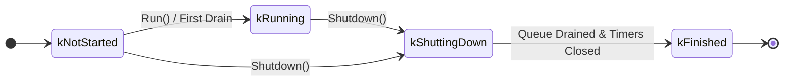
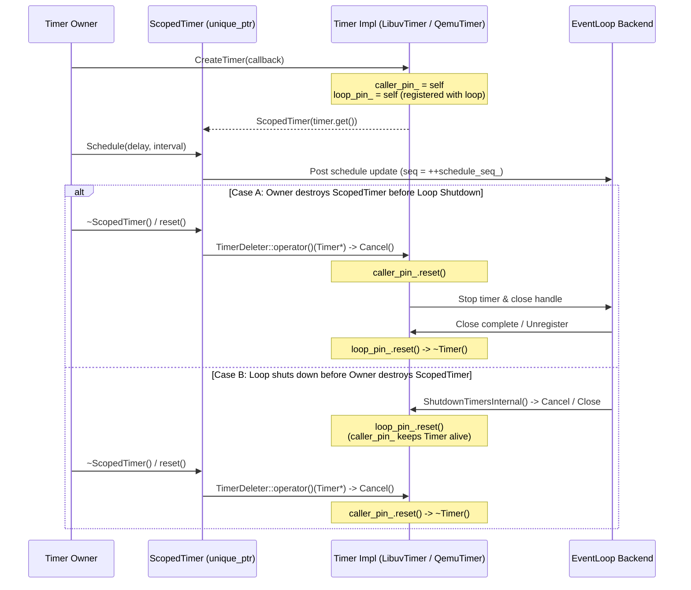

# Asynchronous Event Loop & I/O Subsystem Design

`emulator/libs/async` (`namespace goldfish::async`) provides the core asynchronous execution, timer, socket, process, and signal abstractions used across the Android Emulator. It decouples high-level emulator services, device models, and gRPC controllers from the underlying execution backend—whether backed by a standalone `libuv` reactor thread, the QEMU main loop under the Big QEMU Lock (BQL), a guest vCPU thread, or a deterministic unit-test harness.

Public headers are located under [`include/goldfish/async/`](include/goldfish/async/), with deterministic test doubles in [`include/goldfish/async/testing/`](include/goldfish/async/testing/).

---

## 1. System Overview & Core Abstractions

```mermaid
classDiagram
    direction TB

    class CallbackEventSource~LooperStatusEvent~ {
        <<interface>>
        +AddListener(EventCallback) CallbackSubscription
        +NotifyListeners(LooperStatusEvent)
    }

    class EventLoop {
        <<abstract>>
        +Post(Task, Duration, PostTaskOptions) StatusOr~future~
        +PostAndWait(Task) flatten_status_or_t
        +CreateTimer(Task) ScopedTimer
        +ScheduleDelayed(Task, Duration) ScopedTimer
        +ScheduleRepeating(Task, Duration) ScopedTimer
        +WaitUntilIdle(Duration) Status
        +Shutdown() future~Status~
        +ShutdownTimers()
        +IsOnLoopThread() bool
        +GetState() State
    }

    class LibuvEventLoop {
        -uv_loop_t loop_
        -uv_async_t wakeup_async_
        +Run() Status
        +uv_loop() uv_loop_t*
    }

    class ThreadedEventLoop {
        -unique_ptr~LibuvEventLoop~ loop_
        -thread runner_
        +Create(timeout)$ StatusOr~unique_ptr~ThreadedEventLoop~~
        +uv_loop() uv_loop_t*
    }

    class QemuEventLoop {
        -UniqueQemuBh drainer_bh_
        +HandleSnapshotProgress(SnapshotProgressEvent)
    }

    class TestEventLoop {
        -priority_queue~ScheduledTask~ scheduled_tasks_
        -Duration now_
        +RunOne() bool
        +RunMany(count) size_t
        +RunAll() size_t
        +AdvanceClock(Duration) size_t
    }

    CallbackEventSource~LooperStatusEvent~ <|-- EventLoop
    EventLoop <|-- LibuvEventLoop
    EventLoop <|-- ThreadedEventLoop
    EventLoop <|-- QemuEventLoop
    EventLoop <|-- TestEventLoop
    ThreadedEventLoop *-- LibuvEventLoop : owns & drives on std::thread
```

### 1.1 `EventLoop`

[`EventLoop`](include/goldfish/async/event_loop.h) is the central abstract base class representing an execution context bound to a single logical thread. It provides:

- **Task Posting (`Post`, `PostAndWait`)**: Enqueues callable tasks for immediate or delayed execution on the loop thread, with optional `std::future<T>` result propagation or synchronous caller blocking.
- **Timer Management (`CreateTimer`, `ScheduleDelayed`, `ScheduleRepeating`)**: Creates single-owner RAII timer handles (`EventLoop::ScopedTimer`) backed by the loop's clock source.
- **Lifecycle Notifications**: Inherits from `CallbackEventSource<LooperStatusEvent>` so subscribers can observe loop state transitions.
- **Crash Forensics (`LooperBreadcrumbTracker`)**: Embeds a lock-free 4096-byte circular Crashpad `DynamicBinaryAnnotation` buffer (`looper-trace-<ptr>`) that records task post and execution breadcrumbs keyed by `FlowId` (`uint16_t`).

### 1.2 Concrete Loop Implementations

| Implementation | Header / Source | Backing Mechanism | Primary Use Case |
| :--- | :--- | :--- | :--- |
| **`LibuvEventLoop`** | [`libuv_event_loop.h`](include/goldfish/async/libuv_event_loop.h)<br>[`libuv_event_loop.cc`](libuv_event_loop.cc) | `uv_loop_t` + `uv_async_t` wakeup handle (`uv_run(UV_RUN_DEFAULT)`) | Dedicated I/O, socket, subprocess, and signal handling on a caller-driven thread. |
| **`ThreadedEventLoop`** | [`threaded_event_loop.h`](include/goldfish/async/threaded_event_loop.h)<br>[`threaded_event_loop.cc`](threaded_event_loop.cc) | Owns a `LibuvEventLoop` and drives `Run()` on an internal `std::thread` | Turnkey background worker loop (`ThreadedEventLoop::Create()` blocks until the worker thread is actively running). |
| **`QemuEventLoop`** | [`qemu_event_loop.h`](include/goldfish/async/qemu_event_loop.h)<br>[`qemu_event_loop.cc`](qemu_event_loop.cc) | QEMU main-loop `QEMUBH` (`qemu_bh_new`) and `QEMUTimer` on `QEMU_CLOCK_VIRTUAL` | Marshaling device, display, audio, and snapshot operations onto the QEMU main thread under the BQL. |
| **`TestEventLoop`** | [`testing/test_event_loop.h`](include/goldfish/async/testing/test_event_loop.h)<br>[`test_event_loop.cc`](test_event_loop.cc) | Internal command-driven worker thread with a simulated monotonic clock and min-heap of `ScheduledTask`s | Deterministic unit testing (`RunOne()`, `RunMany()`, `RunAll()`, `AdvanceClock()`). |

In addition, [`VCpuEventLoop`](../../plugin/avd/vcpu_event_loop.h) (`emulator/plugin/avd`) implements `EventLoop` to schedule tasks onto a guest vCPU thread via `aemu_cpus_run_async`.

### 1.3 Cross-Thread Event Dispatch (`EventLoopDispatcher` & `LoopBoundCallbackSource`)

[`include/goldfish/async/event_loop_dispatcher.h`](include/goldfish/async/event_loop_dispatcher.h) bridges arbitrary `CallbackEventSource<T>` producers to an `EventLoop`:

- **`EventLoopDispatcher<T>`**: Wraps an existing `CallbackEventSource<T>` and posts each emitted event onto a target `EventLoop` so listeners execute on the loop thread without holding the producer's lock.
- **`LoopBoundCallbackSource<T>`**: Composes a `CallbackEventSource<T>` with an `EventLoopDispatcher<T>` to expose a source whose `NotifyListeners(event)` method automatically marshals notifications onto the bound `EventLoop`.

---

## 2. Threading Model & Concurrency Invariants

### 2.1 Single-Thread Affinity (`IsOnLoopThread()`)

Every `EventLoop` instance is bound to at most one execution thread at a time. Calling `IsOnLoopThread()` returns `true` if and only if the caller is currently executing on that loop's thread:

- **`LibuvEventLoop`**: Records `loop_thread_id_ = std::this_thread::get_id()` when `Run()` transitions the loop to running, and resets `loop_thread_id_` to `std::thread::id{}` when `Run()` exits.
- **`QemuEventLoop`**: Tracks the QEMU main loop thread executing bottom-half task drainage (`DrainQueue()`).
- **`TestEventLoop`**: Binds `loop_thread_id_` to its internal deterministic worker thread (`WorkerLoop()`), ensuring that tasks running inside `RunAll()` or `AdvanceClock()` observe `IsOnLoopThread() == true` while the test harness thread calling `Post()` or `AdvanceClock()` observes `IsOnLoopThread() == false`.

### 2.2 QEMU Big QEMU Lock (BQL) Invariants

In QEMU, main-loop bottom halves (`QEMUBH`) and timer callbacks (`QEMUTimer`) execute on the QEMU main loop thread while holding the Big QEMU Lock (`bql_locked() == true`). Guest vCPU threads or device I/O threads may also acquire the BQL when invoking device callbacks or tearing down resources.

`QemuEventLoop` enforces the following concurrency invariants:

1. **Deadlock-free `PostAndWait` guard**: `EventLoop::PostAndWait()` checks `IsOnLoopThread()` and terminates immediately with `LOG(FATAL)` if called from the loop thread itself, preventing self-deadlock.
2. **Thread-safe `QEMUTimer` deactivation**: QEMU's `timer_del(&qemu_timer_handle_)` is internally synchronized by QEMU's `QEMUTimerList::active_timers_lock`, and `QemuEventLoopImpl::active_timers_` is guarded by `active_timers_mutex_`. `QemuTimer::Cancel()` sets `cancelled_ = true`, calls `timer_del()`, and unregisters the timer from `active_timers_`, then waits on `callback_cv_` if an `OnTimer()` callback is currently executing on the loop thread.

### 2.3 Lock-Ordering Hierarchy

Across all loop implementations, locks obey a strict hierarchy from outer to inner:

```text
Caller / Service Mutex (M)  --->  EventLoop Thread Execution (PostAndWait / ~ScopedTimer)  --->  Internal Queue / Timer Mutexes
```

Because `PostAndWait()`, off-thread `~ScopedTimer()` (on `LibuvEventLoop`), and off-thread `CreateTimer()` (on a running `LibuvEventLoop`) block waiting for the loop thread to execute a task:

- **Rule 1**: If a callback running on `EventLoop` acquires a mutex `M`, callers on other threads must **never** call `PostAndWait()`, `CreateTimer()`, or `~ScopedTimer()` / `ScopedTimer::reset()` while holding `M`.
- **Rule 2**: `Post()` and `Timer::Schedule()` only acquire internal queue/timer leaf mutexes and never wait for the loop thread; they are safe to call while holding `M`.

---

## 3. Lifecycle State Machine



### 3.1 Monotonic Lifecycle Progression

An `EventLoop` progresses monotonically toward termination:

1. **`kNotStarted`**: Initial state prior to entering the loop's run cycle. Tasks and timers may be registered ahead of startup.
2. **`kRunning`**: Active state in which the loop executes posted tasks and fires expired timers.
3. **`kShuttingDown`**: Entered when `Shutdown()` is invoked. New task posts are rejected with `absl::UnavailableError("Event loop is shutting down.")`. The loop drains already-queued tasks, cancels all active timers via `ShutdownTimersInternal()`, and closes internal wakeup handles.
4. **`kFinished`**: Terminal state reached once all queued tasks and active timers have been torn down. Any subsequent `PostAndWait()` returns `absl::FailedPreconditionError`, and `CreateTimer()` returns an inert, pre-cancelled handle. A `kFinished` loop can never be restarted.

*(On `QemuEventLoop`, `LooperStatusEvent::State::kPaused` is also emitted while a VM snapshot save or load is in progress; once `Shutdown()` is initiated, `kShuttingDown` and `kFinished` are terminal.)*

### 3.2 `LibuvEventLoop` Lifecycle Synchronization

`LibuvEventLoopImpl` tracks `enum class LifecycleState { kNotStarted, kRunning, kFinished }` under `lifecycle_mutex_`:

- **`kNotStarted`**: `uv_loop_init` and `uv_async_init` have completed, but `Run()` has not yet entered `uv_run`. Timers created in this state call `uv_timer_init` directly under `lifecycle_mutex_`.
- **`kRunning`**: `Run()` is actively executing `uv_run` on `loop_thread_id_`. Off-thread operations that mutate `uv_loop_t` handles (`LibuvTimer::Create` and `LibuvTimer::Cancel`) synchronize with the loop thread via `PostAndWait`.
- **`kFinished`**: `uv_run` has exited and all handles have closed.

---

## 4. Timer Subsystem, Design Choices & Trade-offs

### 4.1 Single-Owner RAII via `ScopedTimer`

`EventLoop::ScopedTimer` is a move-only `std::unique_ptr` with a custom deleter:

```cpp
class EventLoop : public CallbackEventSource<LooperStatusEvent> {
  public:
    struct TimerDeleter;

    class Timer {
      protected:
        friend struct EventLoop::TimerDeleter;
        virtual void Cancel() = 0;

      public:
        virtual ~Timer() = default;
        virtual void Schedule(absl::Duration new_delay,
                              absl::Duration new_interval) = 0;
        void Schedule(absl::Duration new_delay) {
            Schedule(new_delay, absl::ZeroDuration());
        }
    };

    struct TimerDeleter {
        void operator()(Timer* t) const { t->Cancel(); }
    };

    using ScopedTimer = std::unique_ptr<Timer, TimerDeleter>;
};
```

- **Fire-and-forget delayed tasks** use `EventLoop::Post(task, delay)` (`PostDelayed`), where the loop manages the one-shot timer internally.
- **Cancellable or reschedulable timers** use `CreateTimer`, `ScheduleDelayed`, or `ScheduleRepeating` and store the returned `ScopedTimer` tied to the owning object's scope.

### 4.2 Architectural Choices & Trade-offs

| Design Choice | Alternative Considered | Rationale & Trade-offs |
| :--- | :--- | :--- |
| **`ScopedTimer = std::unique_ptr<Timer, TimerDeleter>` with `protected` `Timer::Cancel()`** | Copyable `std::shared_ptr<Timer>` handle with a public `Cancel()` method and a separate RAII wrapper class. | - **Single ownership:** Move-only `unique_ptr` semantics ensure ownership of a timer resides in a single explicit scope; accidental copies into lambdas cannot extend timer lifetime past the owner.<br>- **Single cancellation path:** Making `Cancel()` `protected` (invoked solely by `TimerDeleter`) eliminates non-null "zombie" timer pointers that have been cancelled but not reset.<br>- **Zero wrapper allocation:** `ScopedTimer` stores the raw `Timer*` directly with no secondary heap allocation. |
| **Blocking RAII cancellation (`~ScopedTimer()` waits for in-flight callback completion)** | Non-blocking `Cancel()` combined with `std::weak_ptr<Owner>` or `std::shared_ptr<Owner>` in every timer callback. | - **Callback safety without viral `shared_ptr`:** Once `~ScopedTimer()` or `timer.reset()` returns, the callback is guaranteed not to be running and never to run again. Timer owners can be plain stack or member objects that capture `this` directly.<br>- **Destructor thread affinity:** Under the `weak_ptr` alternative, if the owner is destroyed on the main thread while the timer callback holds `weak.lock()` on the event loop thread, `~Owner()` runs on the event loop thread when the callback finishes—violating thread affinity.<br>- **Trade-off:** Callers must obey the lock-ordering rule (§2.3) and never hold a mutex acquired by the timer callback while destroying `ScopedTimer` off-thread. |
| **Synchronous `CreateTimer()` + non-blocking `Timer::Schedule()`** | Asynchronous `CreateTimer()` (returning before backend registration) or blocking `Schedule()`. | - **No half-created state:** Synchronous `CreateTimer()` guarantees the backend handle (`uv_timer_t` or `QEMUTimer`) is initialized before the caller can call `Schedule()` or destroy the handle.<br>- **Lock-safe hot-path rescheduling:** Keeping `Schedule()` non-blocking allows callers to pre-allocate timers in constructors and call `Schedule()` freely on hot paths or while holding internal service mutexes (§7.3). |
| **Dual `std::shared_ptr` self-pins (`caller_pin_` + loop pin)** | Single self-pin released on either `Cancel()` or loop shutdown. | - **Decoupled caller and backend lifetimes:** The caller's `ScopedTimer` handle and the event loop's asynchronous handle lifecycle (`uv_close` or `ShutdownTimersInternal`) can end in either order without use-after-free (§4.3). |

### 4.3 Dual-Pin Lifetime Management (`caller_pin_` and Loop Pin)

Because `ScopedTimer` holds a raw `Timer*` while the event loop also references the timer asynchronously, a `Timer` object has **two independent lifetimes** that can end in either order:

1. **Caller handle lifetime (`ScopedTimer`)**: Starts when `CreateTimer()` returns `ScopedTimer(timer.get())` and ends when `TimerDeleter` invokes `t->Cancel()`.
2. **Event-loop registration lifetime**: Starts when the timer is registered with the backend loop (`uv_timer_init`, `timer_init_ms`, etc.) and ends when the backend finishes closing the handle (such as libuv's asynchronous `uv_close` callback `UnpinItselfOnClose`, or `ShutdownTimersInternal()` during loop teardown).

Every timer implementation (`LibuvTimer`, `QemuTimer`, `TestEventLoopImpl::TestTimer`, `VCpuTimer`) maintains two distinct `std::shared_ptr` pins to itself:

- **`caller_pin_`** (`mCallerPin` in `VCpuTimer`): Acquired in `Create(..., Ownership::kCallerScoped)` and moved into a local at the start of `Cancel()` (`auto caller_pin = std::move(caller_pin_);`).
  - If the event loop shuts down and unregisters all active timers while a service object still holds a `ScopedTimer` member, `caller_pin_` keeps the `Timer` alive until the service's destructor runs `~ScopedTimer() -> TimerDeleter -> t->Cancel()`.
  - When a `kCallerScoped` timer's callback returns `false`, the timer disarms (stops further intervals) without closing its backend handle, so the owner can re-arm it later via `Schedule()`.
  - Fire-and-forget timers created by `PostDelayed` pass `Ownership::kLoopManaged` (`caller_pin_ == nullptr`) and self-cancel as soon as they fire.
- **Loop registration pin** (`uv_pin_` in `LibuvTimer`, `pinned_` in `QemuTimer`, `loop_pin_` in `TestTimer`, `mPendingPin` in `VCpuTimer`): Held while the backend handle is registered or closing, and released only when the backend is guaranteed never to touch the timer again:
  - In **`LibuvTimer`**, `uv_pin_` is acquired in `InitOnLoop()` (`uv_timer_init`) and released in `UnpinItselfOnClose()` after `uv_close(&uv_timer_handle_, UnpinItselfOnClose)` completes on the loop thread.
  - In **`QemuTimer`**, `pinned_` is acquired under `active_timers_mutex_` upon registration in `active_timers_` and released when `UnregisterTimer()` or `ShutdownTimersInternal()` removes it and any in-flight callback has completed.



### 4.4 Synchronous Timer Creation

When `CreateTimer()`, `ScheduleDelayed()`, or `ScheduleRepeating()` returns a `ScopedTimer`, the underlying timer handle is initialized and registered with the loop:

- **`QemuEventLoop`**: `QemuTimer::Create()` initializes `qemu_timer_handle_` synchronously on the calling thread via `timer_init_ms(&qemu_timer_handle_, QEMU_CLOCK_VIRTUAL, ...)` under `active_timers_mutex_` and inserts the timer into `active_timers_`. Because `timer_init_ms` only populates `QEMUTimer` fields (`expire_time = -1`, callback pointer, opaque pointer) without mutating QEMU's active timer list, no `PostAndWait` round-trip to the QEMU main thread is needed.
- **`LibuvEventLoop`**: Because `uv_timer_init()` inserts the handle into `uv_loop_t`'s non-thread-safe `handle_queue`, `LibuvTimer::Create()` inspects `lifecycle_state_` under `lifecycle_mutex_`:
  - On the loop thread (`IsOnLoopThread() == true`), or while `LifecycleState::kNotStarted` (holding `lifecycle_mutex_` so `Run()` cannot concurrently enter `uv_run`), `LibuvTimer::Create()` calls `InitOnLoop()` inline.
  - Off the loop thread while `LifecycleState::kRunning`, `LibuvTimer::Create()` executes `InitOnLoop()` synchronously via `PostAndWait()`.
  - While `LifecycleState::kFinished` or shutting down, `LibuvTimer::Create()` marks the timer `cancelled_ = true` and returns immediately without touching `uv_loop_t`.

### 4.5 Non-Blocking `Schedule()`, Deadline Replacement & Sequence Fencing

`Timer::Schedule(new_delay, new_interval)` is asynchronous and non-blocking, posting the `uv_timer_start` or `timer_mod` update to the loop thread.

Calling `Schedule()` on an already-armed `ScopedTimer` **replaces** its pending deadline and interval rather than queueing an additional expiration:

- **Trailing-edge debouncing / idle timeouts**: Calling `Schedule(timeout)` on every incoming event pushes the deadline out until activity stops.
- **Leading-edge coalescing**: Calling `Schedule(window)` only when transitioning from idle to dirty (`!pending_.has_value()`) bounds latency under steady load without starving flushes (see §7.3).
- **Independent delayed events**: Callers that need every delayed callback to fire independently rather than replacing a single timer's deadline use `EventLoop::Post(task, delay)`.

To prevent a stale queued `Schedule()` task or a racing expiration from firing after a newer `Schedule()` call:

1. Each call to `Schedule()` atomically increments `const uint64_t seq = ++schedule_seq_;` and posts a task capturing `seq` to the loop thread.
2. When the task runs on the loop thread, if `seq != schedule_seq_.load()`, a newer `Schedule()` call has superseded it and the stale update returns early.
3. Otherwise, the loop thread records `active_schedule_seq_ = seq` and arms the backend timer (`uv_timer_start` or `timer_mod`).
4. When `OnTimer()` fires, it verifies `!cancelled_.load()` and `active_schedule_seq_ == schedule_seq_.load()` before invoking `task_()`.

### 4.6 Clock Domains & Starvation Detection

| Backend | Clock Domain | Resolution & Semantics |
| :--- | :--- | :--- |
| **`QemuEventLoop`** | `QEMU_CLOCK_VIRTUAL` (milliseconds) | Advances with guest virtual time; pauses automatically when the guest VM is paused (e.g., during snapshot save/load). If a repeating timer falls more than `3 * interval_ms` behind virtual time, `QemuTimer` logs a starvation warning and resets its deadline to `now + interval_ms` to prevent catch-up bursts. |
| **`LibuvEventLoop`** | Host monotonic clock (`uv_now`, milliseconds) | Driven by OS monotonic time (`CLOCK_MONOTONIC` / `QueryPerformanceCounter`) independent of guest VM state. |
| **`TestEventLoop`** | Simulated manual clock (`now_`, `absl::Duration`) | Advances only on explicit calls to `AdvanceClock(duration)`, executing expired timers in strict deadline order. |

---

## 5. Task Queueing & Shutdown Draining

### 5.1 Producer-Consumer Task Queue

Each `EventLoop` maintains a mutex-guarded task queue (`task_queue_`) and wakes its backend thread when transitioning from empty to non-empty:

- **`LibuvEventLoop`**: Signals `uv_async_send(&wakeup_async_)`. On the loop thread, `ProcessTasks()` swaps `task_queue_` into a local queue under `queue_mutex_` and executes the batch without holding the lock.
- **`QemuEventLoop`**: Schedules a QEMU bottom half (`qemu_bh_schedule(drainer_bh_.get())`) on `qemu_aio_context`. On the QEMU main thread, `DrainQueue()` swaps `task_queue_` into a local vector under `queue_mutex_` and executes each task.

### 5.2 Shutdown Draining Guarantees

When `Shutdown()` is called on an `EventLoop`:

1. **Task Cutoff**: `is_shutting_down_` is set under the queue mutex and the loop transitions to `kShuttingDown`. Subsequent `Post()` calls fail with `absl::UnavailableError`.
2. **Complete Queue Drain**: All tasks enqueued prior to the `Shutdown()` cutoff are drained and executed on the loop thread before shutdown completes.
3. **Synchronous Timer Teardown**: `ShutdownTimersInternal()` cancels and unregisters all active timers before the loop transitions to `kFinished` and fulfills the `Shutdown()` future.

---

## 6. Socket, Process, and Signal Integration

Beyond tasks and timers, `emulator/libs/async` provides non-blocking OS I/O primitives built on `LibuvEventLoop`:

| Component | Header / Implementation | Responsibility |
| :--- | :--- | :--- |
| **`AsyncSocket`** & **`AsyncSocketServer`** | [`async_socket.h`](include/goldfish/async/async_socket.h)<br>[`async_socket_factory.h`](include/goldfish/async/async_socket_factory.h)<br>[`libuv_sockets.cc`](libuv_sockets.cc) | Non-blocking TCP/pipe stream sockets and listening servers created via `LibuvAsyncSocketFactory`. |
| **`ScopedAsyncResource<T>`** (`ScopedAsyncSocket`, `ScopedAsyncSocketServer`) | [`scoped_async_resource.h`](include/goldfish/async/scoped_async_resource.h) | Move-only RAII wrapper (`std::unique_ptr` semantics) that invokes `Close()` when leaving scope, preventing callbacks from firing after owner destruction. |
| **`UvProcessLauncher`** | [`libuv_process_launcher.h`](include/goldfish/async/libuv_process_launcher.h)<br>[`libuv_process_launcher.cc`](libuv_process_launcher.cc) | Spawns and monitors child processes via `uv_spawn`, piping `stdin`/`stdout`/`stderr` and delivering exit status on the loop thread. |
| **`UvSignalHandlers`** | [`libuv_signal_handlers.h`](include/goldfish/async/libuv_signal_handlers.h)<br>[`libuv_signal_handlers.cc`](libuv_signal_handlers.cc) | Registers `uv_signal_t` watchers to marshal POSIX/Windows process signals (`SIGINT`, `SIGTERM`, `SIGCHLD`) onto the `LibuvEventLoop` thread. |

For detailed sequence diagrams of socket I/O lifecycles, see:
- [`docs/socket_read_flow.md`](docs/socket_read_flow.md)
- [`docs/socket_write_flow.md`](docs/socket_write_flow.md)
- [`docs/server_connection_flow.md`](docs/server_connection_flow.md)
- [`docs/backpressure_flow.md`](docs/backpressure_flow.md)
- [`docs/event_loop_primitives.md`](docs/event_loop_primitives.md)
- [`docs/process_launching.md`](docs/process_launching.md)

---

## 7. Common Usage Patterns

### 7.1 Fire-and-Forget `Post` and Future-Returning `Post`

```cpp
// 1. Fire-and-forget void task (zero future/promise allocation fast path):
loop->Post([this]() {
    ProcessNextFrame();
});

// 2. Fire-and-forget delayed task (loop manages one-shot timer internally):
loop->Post([this]() {
    EmitTimeoutMetric();
}, absl::Seconds(5));

// 3. Value-returning asynchronous task (returns absl::StatusOr<std::future<int>>):
auto future_res = loop->Post([]() -> int {
    return ComputeSnapshotChecksum();
});
if (future_res.ok()) {
    int checksum = future_res->get();
}
```

### 7.2 Synchronous Cross-Thread Execution (`PostAndWait`)

`PostAndWait` blocks the calling thread using a stack-allocated `absl::Notification` and `std::optional<ReturnType>` (zero heap `std::promise`/`std::future` allocation, and `ReturnType` does not need to be default-constructible). Return types are automatically flattened via `android::status::flatten_status_or_t<R>`:

- `void` or `absl::Status` callable $\rightarrow$ returns `absl::Status`.
- `T` or `absl::StatusOr<T>` callable $\rightarrow$ returns `absl::StatusOr<T>`.

```cpp
// Calling from a gRPC handler thread onto the QEMU main loop:
absl::StatusOr<DisplayConfig> config = qemu_loop->PostAndWait(
    [this]() -> absl::StatusOr<DisplayConfig> {
        // Runs on QEMU main thread under the BQL.
        return QueryActiveDisplayConfigLocked();
    });
```

### 7.3 Pre-Allocated `ScopedTimer` with Mutex-Safe Rescheduling

When a class arms or reschedules a timer from methods that hold an internal mutex `M`:

1. Declare `EventLoop::ScopedTimer` **after** `M` and any state accessed by the timer callback so C++ reverse member destruction order cancels the timer *before* destroying the state or mutex.
2. Pre-allocate the timer in the constructor (where `M` is not held) via `loop_->CreateTimer(...)`.
3. Call `timer_->Schedule(delay)` inside methods holding `M` (`Schedule()` is non-blocking).

```cpp
class FrameCoalescer {
  public:
    explicit FrameCoalescer(goldfish::async::EventLoop* loop)
        : loop_(loop),
          flush_timer_(loop_->CreateTimer([this]() {
              OnFlushTimer();
              return false;
          })) {}

    ~FrameCoalescer() = default;  // ~flush_timer_ runs first, cancelling before ~mutex_

    void OnNewFrame(Frame frame) {
        absl::MutexLock lock(&mutex_);
        const bool arm_timer = !pending_frame_.has_value();
        pending_frame_ = std::move(frame);
        if (arm_timer) {
            // Leading-edge coalesce: arm once per batch so steady traffic does not
            // push the deadline out indefinitely. Non-blocking under mutex_.
            flush_timer_->Schedule(absl::Milliseconds(16));
        }
    }

  private:
    void OnFlushTimer() {
        absl::MutexLock lock(&mutex_);
        if (pending_frame_.has_value()) {
            FlushLocked(*std::move(pending_frame_));
            pending_frame_.reset();
        }
    }

    goldfish::async::EventLoop* const loop_;
    absl::Mutex mutex_;
    std::optional<Frame> pending_frame_ ABSL_GUARDED_BY(mutex_);
    // Declared last so ~ScopedTimer() cancels and joins any in-flight callback
    // before pending_frame_ and mutex_ are destroyed.
    goldfish::async::EventLoop::ScopedTimer flush_timer_;
};
```

### 7.4 Cancelling a `ScopedTimer` Outside a Mutex Scope

If a method needs to cancel a `ScopedTimer` member while acquiring a mutex `M`, declare a local `ScopedTimer` **before** `absl::MutexLock` and move the member into it so `~ScopedTimer()` runs after `M` is unlocked:

```cpp
void StreamInputReader::OnCancel() {
    bool should_finish = false;
    {
        // Declared before `lock` so `~ScopedTimer()` runs after `reactor_lock_`
        // is released (reverse declaration order at block exit).
        ::goldfish::async::EventLoop::ScopedTimer timer_to_cancel;
        absl::MutexLock lock(this->reactor_lock_);
        cancelled_ = true;
        if (state_ == State::kWaitingForTimer) {
            timer_to_cancel = std::move(pending_timer_);
            should_finish = true;
        }
    }
    if (should_finish) {
        FinishStream(::grpc::Status::CANCELLED);
    }
}
```

### 7.5 Deterministic Unit Testing with `TestEventLoop`

```cpp
auto loop = goldfish::async::testing::TestEventLoop::Create();
int count = 0;

auto timer = loop->ScheduleRepeating(
    [&]() {
        ++count;
        return true;
    },
    absl::Milliseconds(10), absl::Milliseconds(10));

// Advancing the simulated clock runs each scheduled interval deterministically:
loop->AdvanceClock(absl::Milliseconds(10));
loop->AdvanceClock(absl::Milliseconds(10));
loop->AdvanceClock(absl::Milliseconds(10));
EXPECT_EQ(count, 3);

// Resetting ScopedTimer cancels further expirations:
timer.reset();
loop->AdvanceClock(absl::Milliseconds(10));
EXPECT_EQ(count, 3);
```
