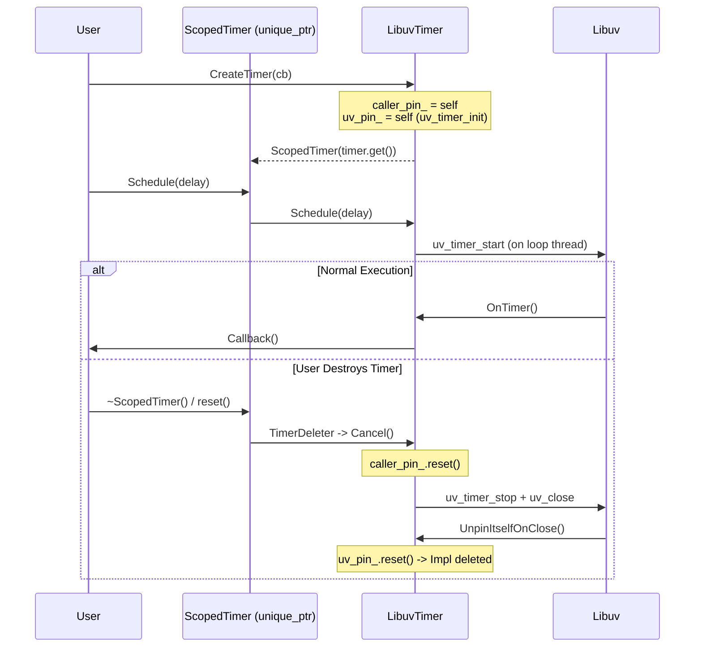

# Event Loop Primitives

This document details the core mechanisms of the `LibuvEventLoop`, specifically how it handles cross-thread task scheduling and time-based events.

## 1. Task Scheduling (Thread Safety)

The `EventLoop` guarantees that all callbacks (sockets, timers, tasks) run on a single dedicated thread. To achieve this from other threads, it uses a **Producer-Consumer** queue guarded by a mutex and signaled via `uv_async_send`.

### Flow Diagram

```mermaid
sequenceDiagram
    participant Caller as Any Thread
    participant Loop as LibuvEventLoop
    participant Queue as std::queue<Task>
    participant Libuv as libuv (uv_async)

    Note over Caller, Libuv: Thread: Any

    Caller->>Loop: Post(Task)
    Loop->>Queue: push(Task) (Locked)
    Loop->>Libuv: uv_async_send(async_handle)
    Note right of Libuv: Wakes up Loop Thread

    Note over Caller, Libuv: Thread: Loop Thread

    Libuv->>Loop: AsyncCallback()
    Loop->>Queue: swap(local_queue) (Locked)

    loop For each Task
        Loop->>Loop: Task()
    end
```

### Key Components
*   **`uv_async_send`**: A thread-safe libuv primitive that "pokes" the event loop, causing it to wake up from its blocking wait (poll) and execute a callback.
*   **`task_mutex_`**: Protects the shared task queue.
*   **`ProcessTasks`**: The internal method that drains the queue. It swaps the queue to minimize the time the lock is held.

---

## 2. Timers & RAII (ScopedTimer)

Timers in this library use a strict **RAII (Resource Acquisition Is Initialization)** pattern via `EventLoop::ScopedTimer = std::unique_ptr<Timer, TimerDeleter>`. Destroying or resetting a `ScopedTimer` automatically invokes `TimerDeleter::operator()(Timer*) -> Timer::Cancel()`, ensuring timers are disarmed and any in-flight callback has completed before the owner is destroyed. See [`DESIGN.md`](../DESIGN.md) for the full design and trade-off analysis.

### Dual-Pin Lifetime Management (`caller_pin_` & `uv_pin_`)
Because `ScopedTimer` holds a raw `Timer*` while libuv closes `uv_timer_t` handles asynchronously on the loop thread, `LibuvTimer` maintains two `std::shared_ptr<LibuvTimer>` pins to itself:
1.  **`caller_pin_`:** Held on behalf of the caller's `ScopedTimer` handle (`pin_for_caller = true`) and released when `TimerDeleter` calls `Cancel()`. This prevents use-after-free if the event loop shuts down while the caller still holds `ScopedTimer`.
2.  **`uv_pin_`:** Held while `uv_timer_handle_` is initialized in `uv_loop_t` (`InitOnLoop`) and released only in `UnpinItselfOnClose` after `uv_close` completes on the loop thread.

### Lifecycle Diagram


