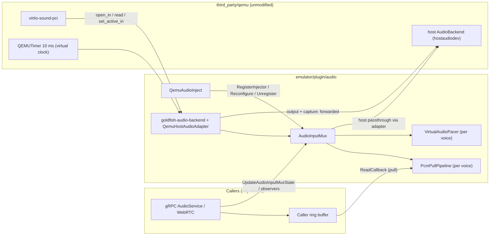
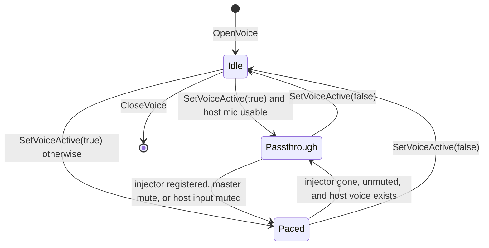
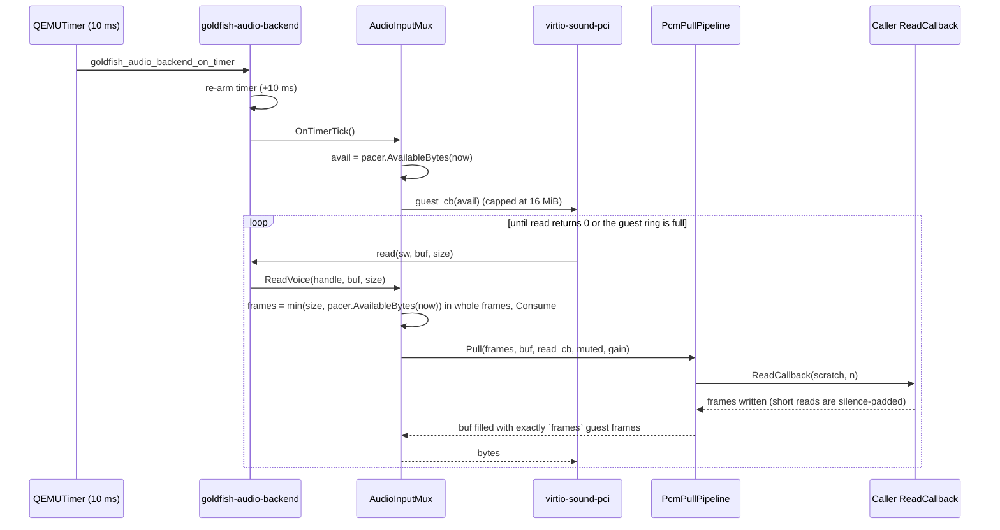

# Microphone Injection Design (`emulator/plugin/audio`)

**Location:** `hardware/generic/goldfish/emulator/plugin/audio`
**Namespace:** `goldfish::audio`
**Related:** [ARCHITECTURE.md](ARCHITECTURE.md) (target/header index),
`emulator/plugin/grpc/services/v2/audio/` (main consumer)

---

## 0. TL;DR

The guest's microphone normally records from the host OS microphone. This package lets emulator
features (the gRPC `AudioService`, WebRTC inbound audio, tests) **replace the guest microphone
with their own PCM audio**. It also adds a small **virtual microphone mixer** (master mute,
host-mic on/off, per-input mute and gain).

It does this **without patching QEMU**: a Goldfish `AudioBackend` wraps the real host audio
backend. Speaker output passes straight through. Microphone input is intercepted and served
either from the host mic or from an injector.

```text
                     ┌──────────────── goldfish-audio-backend ("mainaudiodev") ───────────────┐
 virtio-sound-pci ──►│ output / speaker capture ─────────── forwarded as-is ──────────────────│──► host backend
 (guest)          ◄──│ input ──► AudioInputMux ─┬─ host passthrough ◄── host mic ─────────────│◄── ("hostaudiodev")
                     │                          └─ paced mode ◄── PcmPullPipeline ◄── injector │
                     └────────────────────────────────────────────────────────────────────────┘
```

---

## 1. Where to Start Reading

| File | What it is | Read it when... |
| :--- | :--- | :--- |
| [qemu_audio_inject.h](include/goldfish/audio/qemu_audio_inject.h) | Public API: `QemuAudioInject` (RAII injector) plus `UpdateAudioInputMuxState()` | You want to *use* microphone injection. |
| [audio_input_mux.h](include/goldfish/audio/audio_input_mux.h) / [.cc](audio_input_mux.cc) | Routing state machine, mixer state, observers. Has no QEMU dependency. | You are changing routing, mute/gain, or locking. |
| [goldfish_audio_mux.cc](goldfish_audio_mux.cc) | QOM glue: `goldfish-audio-mux` device, `goldfish-audio-backend` type, `QemuHostAudioAdapter` | You are touching QEMU wiring, timers, or teardown. |
| [pcm_pull_pipeline.h](include/goldfish/audio/pcm_pull_pipeline.h) / [.cc](pcm_pull_pipeline.cc) | Format conversion, channel remix, gain, resampling | You are changing audio conversion. |
| [virtual_audio_pacer.h](include/goldfish/audio/virtual_audio_pacer.h) | Turns elapsed virtual time into a byte budget | You are debugging over- or under-delivery. |
| [pcm_format.h](include/goldfish/audio/pcm_format.h) / [.cc](pcm_format.cc) | Format enums, configs, silence/encode/scale helpers, mixer constants | You need a PCM helper. |
| [virtio_snd_inject_qtest.c](virtio_snd_inject_qtest.c) + [qtest_audio_inject_plugin.cc](qtest_audio_inject_plugin.cc) | End-to-end test that boots real QEMU with `virtio-sound-pci` | You want to see the whole thing run. |
| [test_bql.h](test_bql.h) | Per-thread `VmLock` for unit tests | You write a test that calls the mux. |

`QemuAudioCapture` / `QemuAudioSource` (speaker capture for WebRTC) live in the same package but
are independent of microphone injection. They only bind to `mainaudiodev` like any other client.

---

## 2. QEMU Audio Primer

Read this section if you are new to QEMU audio. Everything else builds on these terms.

| Term | Meaning |
| :--- | :--- |
| **`AudioBackend`** | QOM object under `/audiodevs/<id>` created by `-audiodev`. Devices call it through a vtable (`AudioBackendClass`: `open_in`, `read`, `set_active_in`, `open_out`, `write`, ...). |
| **`SWVoiceIn` / `SWVoiceOut`** | Per-stream handle returned by `open_in` / `open_out`. **Opaque to devices**: `virtio-snd` only passes it back to the backend. That is why we can return our own handle type cast to `SWVoiceIn*`. |
| **`audsettings`** | Stream format the guest asked for (rate, channels, `AudioFormat`, endianness). |
| **`Volume`** | Guest per-channel volume (`0..255`, where `255` means unity) plus a mute flag. |
| **Pull contract** | The backend calls the device's `audio_callback_fn(opaque, avail_bytes)` ("data is ready"). The device then calls `read(be, sw, buf, size)` in a loop until it returns `0` or its ring buffer is full. |
| **BQL** | QEMU's Big QEMU Lock. All device code, `AudioBackendClass` calls, timers, and VM state handlers run with it held. Goldfish code takes it with `RecursiveScopedVmLock`. |
| **`QEMU_CLOCK_VIRTUAL`** | Guest time. Stops while the VM is paused and can jump backwards on snapshot load. |

---

## 3. Why This Design

### 3.1 Problem

We need to (a) feed arbitrary-format PCM into the guest mic, (b) release the host OS mic while
doing so (privacy, and so OS mic indicators turn off), (c) keep working on hosts without any
microphone (headless CI), and (d) avoid carrying patches in `third_party/qemu`.

### 3.2 Chosen approach: decorate the `AudioBackend`

QEMU exposes `AudioBackend` as a public QOM interface (`include/qemu/audio.h`). Every call from
`virtio-sound-pci` dispatches through `AUDIO_BACKEND_GET_CLASS(be)`. So we register a new QOM
type, `goldfish-audio-backend`, that **wraps** the real backend:

1. **No `third_party/qemu` changes.** No C patches, QAPI changes, or `.def` exports, so there
   are no merge conflicts on QEMU uprevs.
2. **Works without a host mic.** If the host backend cannot open a capture voice
   (`open_in == nullptr`), the mux still serves paced silence and switches to injected audio
   on demand.
3. **Better resampling.** `webrtc::SincResampler` (32-tap windowed sinc, SIMD) instead of QEMU's
   linear interpolator.
4. **Testable.** Routing, pacing, and conversion live in plain C++ (`AudioInputMux`,
   `PcmPullPipeline`, `VirtualAudioPacer`). Unit tests run them under ASAN/TSAN with fakes, and
   one `qtest` checks the real QEMU integration.
5. **One lock.** QEMU already serializes every audio callback with the BQL, so the mux reuses it
   instead of adding its own locks (§6).

### 3.3 Goals

- Pull-driven: injected frames are pulled on QEMU's demand via `ReadCallback`. Nothing is pushed.
- One injector at a time (`kMaxConcurrentMicrophoneStreams == 1`). A second `Start()` fails
  with `AlreadyExistsError`.
- Any caller format: `U8/S16/S32/F32`, any rate, 1–16 channels. The caller's format is converted
  to whatever the guest opened. `Reconfigure()` changes it in place.
- Mixer controls: master mute, plus per-input mute and linear gain `[0.0, 4.0]` for the host mic
  and the injector, with state observers.
- Correct timing on the virtual clock: no ring-buffer overruns, no drift, recovery after
  snapshot loads and VM pause/resume.

### 3.4 Non-goals

- **Push-to-pull buffering.** Push producers (gRPC streams, WebRTC tracks) own their jitter/ring
  buffer and expose it through `ReadCallback`. See `QemuMicrophoneSession` in
  `audio_service_impl.cc` for an example.
- **Mixing several injectors.** Rejected today. Mixing would be a future extension (see §10).

---

## 4. How It Fits Together



### 4.1 Startup wiring

QEMU creates `-audiodev` backends before it realizes `-device` entries in command-line order.
Goldfish relies on that order:

1. **Type registration.** `GF_REGISTER_TYPES_FUNC` ([plugin.cc](../plugin.cc)) calls
   `audio_mux_register_types()`, which registers `goldfish-audio-backend`
   (`parent = TYPE_AUDIO_BACKEND`) and `goldfish-audio-mux` (`parent = TYPE_DEVICE`).
2. **Launcher command line** (`AudioDevice::getQemuParameters`, ARM/x86 only):
   ```text
   -audiodev <driver>,id=hostaudiodev,<settings>
   -device goldfish-audio-mux,host-audiodev=hostaudiodev,audiodev-id=mainaudiodev[,allow-host-audio=on]
   -device virtio-sound-pci,audiodev=mainaudiodev,addr=09.0
   ```
   - **The host microphone is off by default.** `allow-host-audio=on` is added only when the user
     passes `-allow-host-audio`. Without it, the device mutes the `"host"` mixer input while it is
     set up, so the guest gets silence (or injected audio) and the host capture voice is never
     activated. Clients can still unmute `"host"` at runtime through `UpdateAudioState`.
   - When no host audio server is detected, `<driver>` is `none` with `mixing-engine=on`, so
     QEMU's own audio pacing still works.
   - With `-no-audio`, `<driver>` is `none` with `mixing-engine=off`. **The mux is still wired**,
     so injection still works. RISC-V AVDs get no audio devices at all.
3. **Realize** (`goldfish_audio_mux_dev_realize`):
   - looks up `/audiodevs/hostaudiodev` and takes a reference to it,
   - creates the `goldfish-audio-backend`, its `QEMUTimer`, `QemuHostAudioAdapter`,
     `AudioInputMux`, and VM state handler,
   - registers the mux in a global registry (`AudioBackend*` → `weak_ptr<AudioInputMux>`),
   - adds the wrapper as `/audiodevs/mainaudiodev`.

   `virtio-sound-pci` and `QemuAudioCapture` then bind to `mainaudiodev` as usual.

### 4.2 Routing: the two modes

Each guest input voice (a `MuxVoiceHandle`) is always in one of three states. `ApplyRouting()`
recomputes this at the end of **every** mutation:

```text
use_host_mic = !microphone_muted_ && !host_input_.muted && !active_injector_
if (!guest_active)                        → Idle
else if (use_host_mic && host_voice)      → Host passthrough
else                                      → Paced
```

| Mode | Where audio comes from | Who says "data ready" | Host OS mic |
| :--- | :--- | :--- | :--- |
| **Idle** | nothing (`read` returns 0) | nobody | off |
| **Host passthrough** | `host_be->read()`, then scaled by the `"host"` input gain | the host backend's own timer → `OnHostDataAvailable` | **on** |
| **Paced** | injector through `PcmPullPipeline`, or format-correct silence | our 10 ms `QEMUTimer` → `OnTimerTick` | **off** |

What the guest hears in paced mode:

| Situation | Guest hears |
| :--- | :--- |
| Injector active, nothing muted | injected audio × guest volume × injector gain |
| Injector active, master mute or injector input muted | silence, **but the injector is still pulled at 1.0x** (see §8) |
| No injector (`"host"` input muted, master mute, or no physical host mic) | silence |



When a voice switches into Paced mode, `ApplyRouting` **resets its pacer** to "now" and
**flushes its resampler**, so no stale backlog or delay-line audio remains. It also
**deactivates the host voice**, which releases the OS mic. Resets are also forced on
`RegisterInjector`, `UnregisterInjector`, a guest voice re-open, and VM resume. The timer is
armed exactly when `vm_running_ && any voice is Paced`.

### 4.3 Read path walkthrough (paced mode)

Everything below runs on one QEMU thread with the BQL held.



In **host passthrough** mode the shape is the same. The host backend's timer calls
`OnHostDataAvailable(voice, avail)`, the mux forwards that to the guest callback, and each
`ReadVoice` becomes `host_->ReadHostVoice()` followed by `ScaleGuestPcmBuffer(host gain)`, which
does nothing at unity gain.

---

## 5. Components

### 5.1 `goldfish-audio-backend` and `QemuHostAudioAdapter` ([goldfish_audio_mux.cc](goldfish_audio_mux.cc))

- **Output and speaker capture slots** (`open_out`, `close_out`, `is_active_out`,
  `set_active_out`, `set_volume_out`, `write`, `get_buffer_size_out`, `add_capture`,
  `del_capture`, `set_dbus_server`) are forwarded unchanged to the host backend.
- **Input slots** (`open_in`, `close_in`, `is_active_in`, `set_active_in`, `set_volume_in`,
  `read`) convert QEMU types (`audsettings`, `Volume`) into plain C++ types (`GuestAudioConfig`,
  `GuestChannelVolume`) and call `AudioInputMux`. The `SWVoiceIn*` handed to `virtio-snd` is
  really a `MuxVoiceHandle*`.
- **`QemuHostAudioAdapter`** implements `HostAudioInputInterface`, the mux's only view of QEMU.
  It opens and closes host voices, toggles them, reads them, arms the timer, and reads the
  virtual clock. Each host voice is a heap `HostVoiceContext` holding the host's `SWVoiceIn*`
  and the mux callback.
  - Re-open contract: if `open_in(existing)` fails, QEMU has **already closed** the old voice.
    The adapter only deletes its context, so there is no double close.
- **Timer and VM state:** `goldfish_audio_backend_on_timer` re-arms itself and calls
  `OnTimerTick()`. The VM change-state handler calls `OnVmRunningChanged()`.

### 5.2 `AudioInputMux` ([audio_input_mux.h](include/goldfish/audio/audio_input_mux.h))

The core of the package. It has no QEMU headers, so tests drive it with a `FakeHostAudioInput`.
The gRPC service also uses a standalone instance with a `NullHostAudioInput` as a pure mixer
state holder ("sink mode", used when `AudioServiceImpl::Options::microphone_sink` is set).

Key data, all protected by the VM lock (§6):

| Member | Meaning |
| :--- | :--- |
| `voices_` (`MuxVoiceHandle`) | One per guest `open_in`: guest format, volume, guest callback, host voice handle (may be null), `guest_active`, `host_voice_active`, `paced`, its `VirtualAudioPacer`, and its `PcmPullPipeline` (only while an injector is registered). |
| `active_injector_` (`Injector`) | The single registered injector: owner, `AudioStreamConfig`, `ReadCallback`, `ActiveCallback`, and its mixer input (`source_id`, `kind`, `muted`, `gain`). |
| `microphone_muted_`, `host_input_` | Master mute, and the `"host"` mixer input (`muted`, `gain`). |

**Every mutation ends with `Commit()`**, which runs three steps in order:

1. `ApplyRouting()` recomputes each voice's mode (§4.2) and toggles host voices and the timer.
2. `ReportGuestActivity()` calls the injector's `ActiveCallback` if "any guest voice active"
   changed since it was last reported. Because `reported_guest_active` starts as `false`,
   registering while the guest records reports `true` immediately.
3. `PublishState()` builds the public `AudioInputStateSnapshot`. If it differs from the published
   copy, it stores it and notifies observers.

`Commit()` runs last because its callbacks may re-enter the mux. For example, an observer may
call `QemuAudioInject::Stop()`. Loops that call out first copy what they need (`OnTimerTick`
collects guest callbacks before invoking them).

**Events emitted:**

- `ActiveCallback(bool)` fires when the *aggregate* "any guest voice active" changes, including
  once during `RegisterInjector` if the guest is already recording.
- State observers fire whenever the published snapshot changes: guest activity, injector
  register/unregister, `source_id` rename, or a mute/gain change. A format-only
  `ReconfigureInjector()` changes nothing visible and does **not** notify.

### 5.3 `VirtualAudioPacer` ([virtual_audio_pacer.h](include/goldfish/audio/virtual_audio_pacer.h))

`virtio-snd` keeps reading until `read()` returns 0. If we always returned data, we would
overwrite unread guest capture periods. The pacer limits delivery to real time on the virtual
clock. It is a plain value type: the mux passes `now` into every call.

```text
due       = (now - anchor) * sample_rate * bytes_per_frame / 1e9   (128-bit math, no drift)
available = floor_to_frames(due - consumed)                        (at most kMaxBacklog = 200 ms)
```

- `AvailableBytes(now)` tells the mux how much may be delivered; `Consume(n)` records delivery.
- If the clock went backwards (snapshot load), the pacer re-anchors to `now`.
- If the guest stalls, debt older than `kMaxBacklog` is forgiven, so the guest never receives a
  long burst. The limit is a duration, so it means the same at every sample rate.

### 5.4 `PcmPullPipeline` ([pcm_pull_pipeline.h](include/goldfish/audio/pcm_pull_pipeline.h))

`Pull(target_frames, dst, pull_source, input_muted, input_gain)` always writes **exactly**
`target_frames` guest frames.

1. **Fast path (`CanUseDirectPassthrough`).** If rate, channels, and sample format match, the
   guest wants native endianness, guest volume is nominal, the input is not muted, and gain is
   1.0, then `pull_source` writes straight into the guest buffer and any short read is padded
   with silence.
2. **General path.** Output is processed in chunks of at most 512 frames
   (`kDefaultChunkFrames`), or less when resampling. All scratch buffers are allocated in the
   constructor, so there are **no heap allocations per pull**.
   1. Pull source frames and pad short reads with format silence.
   2. Decode to float `[-1, 1]` (F32 input: NaN → 0, clamped).
   3. **Downmix before resampling** to `mid = min(src_ch, dst_ch)` channels. Middle channel `m`
      is the average of source channels `m, m+mid, m+2·mid, ...` (stereo→mono averages L and R).
   4. **Resample** with one `webrtc::SincResampler` per middle channel, if rates differ.
   5. **Upmix after resampling**: guest channel `c` takes middle channel `c % mid`
      (mono→stereo duplicates).
   6. Apply `gain[c] = guest_vol[c] / 255 × input_gain`. Force silence if the guest volume is
      muted, `input_muted` is set, or gain ≤ 0. Then clamp and encode to the guest format
      (`S8/U8/S16/U16/S32/U32/F32`, either endianness).

**Multi-channel resampler detail (`ChannelResamplerState`).** Every per-channel `SincResampler`
must consume the *same* source frames. Channel 0's refill callback pulls and decodes one block
into `staged_planar_`. Channels 1..N copy their plane from that staged block. This only works
if each `ResampleStep` triggers **at most one refill**. Step size is therefore capped at
`ChunkSize() / 2` (`MaxStepFrames()`), measured at construction when the block is smallest.
`DCHECK`s enforce this.

**Latency:** when resampling, the first pull after a reset primes the resampler with
`request_frames` source frames (≥ 512, about 10.7 ms at 48 kHz). Add 16 frames of kernel delay.

### 5.5 `pcm_format` ([pcm_format.h](include/goldfish/audio/pcm_format.h))

- Two format enums. `SampleFormat` is the caller side: `U8/S16/S32/F32`, native endian.
  `GuestPcmFormat` is the guest side and mirrors QEMU `AudioFormat` (signed and unsigned
  8/16/32 plus F32, either endianness).
- Helpers: `FillSourceSilence`, `FillGuestSilence` (unsigned formats use midpoint silence,
  e.g. `0x80`), `EncodeGuestSample`, and `ScaleGuestPcmBuffer` (in-place gain for host
  passthrough).
- Also holds the mixer constants (`kHostMicrophoneSourceId = "host"`, gain range,
  `kMaxConcurrentMicrophoneStreams`) and `MicrophoneSourceMetadata` / `MicrophoneInputKind`.

### 5.6 `QemuAudioInject` ([qemu_audio_inject.h](include/goldfish/audio/qemu_audio_inject.h))

RAII handle, symmetric to `QemuAudioCapture`. `Start`, `Reconfigure`, and `Stop` take the BQL,
which serializes them with each other and with guest reads. A small `mutex_` only lets the
getters (`IsRunning`, `config`, `metadata`) run on any thread, and is never held while calling
the mux.

| Call | Behavior |
| :--- | :--- |
| `Start()` | Takes the BQL. Finds the mux (explicit `AudioBackend*`, else `"mainaudiodev"`, else the default audiodev). Marks itself running, then calls `RegisterInjector`. The mux validates the config and `source_id` and returns the final `source_id` (auto-assigned `"stream-<n>"` if empty). Calling it again while running is a no-op. |
| `Reconfigure(cfg, source_id?)` | Changes format and/or `source_id` in place. **Mute and gain are kept.** Pipelines are rebuilt only if the format changed. The new values are stored before the mux call (so observers see them) and rolled back on failure. If not running, the values are only stored. |
| `Stop()` / destructor | Unregisters. Routing falls back to the host mic (if allowed) or paced silence. **No `ReadCallback` runs after it returns**: reads and `Stop()` both need the BQL. Idempotent and thread-safe. |

Errors returned by `Start()`:

| Error | When |
| :--- | :--- |
| `InvalidArgumentError` | Bad config, empty callback, or `source_id == "host"`. |
| `UnavailableError` | No mux is registered (no `goldfish-audio-mux` on the command line, e.g. RISC-V). |
| `FailedPreconditionError` | The mux has already shut down. |
| `AlreadyExistsError` | Another injector owns the microphone. |

Free functions:

- `ResolveTargetAudioInputMux()` finds the mux.
- `UpdateAudioInputMuxState(mux, mutation)` runs `UpdateState` with the BQL held. Use it from
  threads that do not already hold the BQL.

### 5.7 Mixer state API

Use `GetStateSnapshot()` to read (any thread, no lock needed) and `UpdateState(mutation)` (VM
lock required) to change it. `UpdateState` validates the **whole** mutation before applying any
of it. Every input has the same two controls, so there is exactly one way to do each thing.

| Control | Effect |
| :--- | :--- |
| `microphone_muted` | Master mute. Releases the host mic and silences the guest. An active injector **keeps being pulled at 1.0x**. |
| `microphone_inputs["host"]` | Always present at index 0. **Starts muted unless the emulator runs with `-allow-host-audio`** (§4.1). `muted = true` releases the host mic: the guest gets paced silence unless an injector is active. `gain` applies in passthrough mode. |
| `microphone_inputs[<source_id>]` | Present at index 1 while an injector is registered. Has `muted` and `gain`. |

Errors: `InvalidArgumentError` for an empty `source_id` or a gain that is non-finite or outside
`[0, 4]`. `NotFoundError` for an unknown `source_id`. `FailedPreconditionError` after shutdown.

---

## 6. Threading and Locking

### 6.1 One lock: the VM lock

The mux has **no internal lock for routing state**. Every method that reads or changes routing
must be called with the VM lock held (`android::goldfish::VmLock`, which is the BQL in QEMU).
Debug builds check this with `DCHECK(VmLock::Get()->IsLockedBySelf())`.

This costs callers nothing. QEMU already holds the BQL for every `AudioBackendClass` call, timer,
host audio callback, and VM state change. The few callers on other threads take it explicitly.

| Entry point | Thread | How the VM lock is held |
| :--- | :--- | :--- |
| `AudioBackendClass` input slots, `OnTimerTick`, `OnVmRunningChanged`, `OnHostDataAvailable`, `Shutdown` (from `unparent`) | QEMU main loop / vCPU | QEMU already holds it |
| `QemuAudioInject::Start/Reconfigure/Stop`, `UpdateAudioInputMuxState` | any | they take `RecursiveScopedVmLock` |
| gRPC sink mode (`SinkMicrophoneSession`, `InjectClipViaSink`) | gRPC threads | they take `RecursiveScopedVmLock` |
| `GetStateSnapshot`, `IsShutdown`, `Add/RemoveStateObserver`, `QemuAudioInject` getters | any | not needed |

Because everything runs under one lock, calls into the host, guest callbacks, `ReadCallback`,
`ActiveCallback`, and observers happen **inline** on the calling thread. They may re-enter the
mux, because the VM lock is recursive for its owner.

### 6.2 The other locks

| Lock | Guards | Notes |
| :--- | :--- | :--- |
| `AudioInputMux::snapshot_mutex_` | the published `AudioInputStateSnapshot` | Lets any thread read state. Held only to copy. |
| `AudioInputMux::observers_mutex_` | observer list and in-flight counts | Never held while calling an observer. |
| `QemuAudioInject::mutex_` | `config_`, `metadata_`, `mux_` | For the getters. Never held while calling the mux. |

These are all leaf locks: nothing else is acquired while holding them.

### 6.3 Rules

- **Hold the VM lock for mux mutations.** In tests, install a `TestBql` ([test_bql.h](test_bql.h))
  and hold a `ScopedVmLock`. Multithreaded tests release it with `ScopedVmUnlock` and take it per
  operation.
- **Callbacks run with the VM lock held.** Keep them short. Never block on another thread that
  needs the BQL.
- **Observer removal drains.** `RemoveStateObserver(id)` blocks until that observer's in-flight
  calls finish. An observer **may** remove a *sibling* but **must not** remove *itself*, which
  would deadlock.
- **`ReadCallback` is real-time.** It must copy from an in-memory buffer and must not block, wait
  on anything that needs the BQL, or call `Start/Stop` on its own injector.

---

## 7. Lifetime and Shutdown

QEMU's `qemu_cleanup()` runs `audio_cleanup()`, which unparents `/audiodevs`, **before**
`deletable_cleanup()` destroys Goldfish gRPC/WebRTC devices and before `GF_SHUTDOWN_FUNC`. So an
injector can outlive the backend it is attached to.

1. `AudioInputMux` is a `shared_ptr` owned by the backend state *and* by every running
   `QemuAudioInject`. The global registry holds only a `weak_ptr`.
2. `goldfish_audio_backend_unparent` → `TearDownBackendState`, which:
   - removes the mux from the registry,
   - calls `AudioInputMux::Shutdown()` (closes host voices, disarms the timer, drops the
     injector, sets `host_ = nullptr`, marks the mux terminal),
   - detaches the adapter,
   - frees the timer and VM state entry,
   - releases its reference on the host backend.
3. A later `~QemuAudioInject()` calls `UnregisterInjector` on the still-alive but shut-down mux.
   That call is a harmless no-op and never touches freed QOM objects.

`TearDownBackendState` is idempotent. It runs from both `unparent` and `instance_finalize`.

---

## 8. Gotchas and Non-Obvious Invariants

- **Muted still pulls.** When muted, the injector's `ReadCallback` and resampler still run at
  1.0x and the output is replaced with silence. Upstream ring buffers therefore never back up,
  and unmuting never plays stale audio.
- **Handles are fake.** `SWVoiceIn*` values given to `virtio-snd` are `MuxVoiceHandle*`. Never
  pass them to real QEMU audio functions.
- **Guest re-open keeps the handle.** `open_in(existing_sw, ...)` with new `audsettings`
  reconfigures the same voice. Guest volume resets to nominal and the pipeline is rebuilt. If the
  host re-open fails, the voice continues in paced (silent) mode.
- **The guest format is decided by the guest**, not by the launcher's `in.*` settings. Those
  apply only to the host backend's hardware voice, and QEMU's mixing engine converts between
  them.
- **The advertised `avail` is capped at 16 MiB** because QEMU's callback takes a signed `int`.
- **The resampler single-refill invariant** (§5.4) depends on `SincResampler` internals. Re-check
  it if WebRTC is upgraded.

---

## 9. Testing

| Target | Covers |
| :--- | :--- |
| `:virtual_audio_pacer_test` | Exact quotas, 44.1 kHz fractional drift, partial consume, backward clock jump, 200 ms backlog limit at 8 and 48 kHz. |
| `:pcm_pull_pipeline_test` | Fast path, underrun padding (incl. unsigned midpoint), up/downmix (4↔2, 4→1), 48k↔16k and 44.1k→48k resampling SNR, big-endian encode, NaN sanitizing, mute still pulls, gain saturation, `ScaleGuestPcmBuffer`. |
| `:audio_input_mux_test` | Host passthrough, hot swap host↔injector, host-mic-less silence, conflict rejection, VM pause/resume and snapshot jump, late unregister after shutdown, multi-voice aggregate state, re-open, mute stacking, per-input controls with a Unicode `source_id`, observer drain and sibling removal, multithreaded stress under `TestBql` (TSAN), and a death test proving mutations without the VM lock fail the check. |
| `:qemu_audio_inject_test` | Public API errors, end-to-end pull through a registered mux, `AlreadyExists`, survives `audio_cleanup()` first, concurrent start/stop, in-place reconfigure keeps gain, re-entrant observer that calls `Stop()`. |
| `:virtio_snd_inject_qtest` | Real `qemu-system-x86_64 -accel qtest` with `goldfish-audio-mux` + `virtio-sound-pci`: playback passthrough, takeover + resample + restore, `Start()` before guest `PREPARE`, host mic off by default and on with `allow-host-audio=on`, clean teardown. Runs with the real BQL, so it also exercises the lock check. |
| `//emulator/launcher/launch_qemu:audio_device_test` | Command-line order, `none` fallback, `-no-audio` settings, and `-allow-host-audio` → `allow-host-audio=on`. |

```bash
bazel test --config=tsan @goldfish//emulator/plugin/audio:all
bazel test --config=asan @goldfish//emulator/plugin/audio:all
```

---

## 10. Extending

- **New caller sample format.** Add it to `SampleFormat`, `BytesPerSample`, `FillSourceSilence`,
  `DecodeInterleavedToFloat`, and `CanUseDirectPassthrough`. Add a round-trip test in
  `pcm_pull_pipeline_test`.
- **Multiple simultaneous injectors.** Replace `std::optional<Injector>` with a list. Give each
  voice one `PcmPullPipeline` per injector. Sum their float output before encoding:
  `PcmPullPipeline` would need to expose a float-output stage. Then raise
  `kMaxConcurrentMicrophoneStreams` and extend `PublishState`.
- **New mixer control.** Add a field to `AudioInputStateSnapshot` and `AudioInputStateMutation`,
  apply it in `UpdateState`, and make sure `ApplyRouting` accounts for it if it affects routing.
