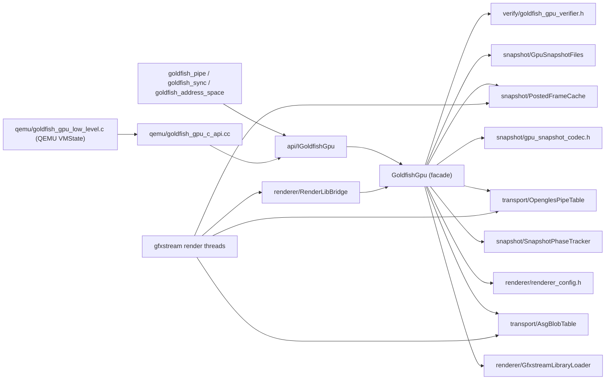

# Component: Legacy GoldfishGpu (`emulator/plugin/legacy/goldfish_gpu`)

**Role:** Hosts the gfxstream renderer for API <= 36 guests, whose graphics
traffic arrives over `goldfish_pipe` ("pipe:opengles"), `goldfish_address_space`
(ASG blobs) and `goldfish_sync` instead of virtio-gpu.
**Location:** `hardware/generic/goldfish/emulator/plugin/legacy/goldfish_gpu`
**Namespace:** `goldfish::legacy`
**Consumers:** `//emulator/plugin/legacy/goldfish_pipe`,
`//emulator/plugin/legacy/goldfish_address_space`,
`//emulator/plugin/legacy/goldfish_sync` (through `IGoldfishGpu`), and the QEMU
VMState shim `goldfish_gpu_low_level.c` (through the C ABI in
`goldfish_gpu_c_api.h`).

## Layout

The package root holds only the facade; each layer is its own Bazel package and
its headers carry the layer in the include path
(`goldfish/legacy/goldfish_gpu/<layer>/<name>.h`). The public headers in `api/`
keep the bare path `goldfish/legacy/goldfish_gpu/<name>.h`, so external
consumers were not touched by the split. Dependencies only point downwards in
this table; `qemu/` sits on top of the facade.

| Directory | Package | Contents |
| :--- | :--- | :--- |
| `.` | `//emulator/plugin/legacy/goldfish_gpu` | `GoldfishGpu` facade (`:facade`), the `:goldfish_gpu` aggregate the devices link, aliases for the external labels (`:impl`, `:impl_<arch>`, `:fake_goldfish_gpu`, `:goldfish_gpu_interface`), the integration test |
| [qemu/](qemu/) | `//emulator/plugin/legacy/goldfish_gpu/qemu` | `goldfish_gpu_c_api.cc` (`qemu:c_api`, the `extern "C"` shim) and `goldfish_gpu_low_level.c` (`qemu:impl`, the VMState sections) |
| [api/](api/) | `//emulator/plugin/legacy/goldfish_gpu/api` | `IGoldfishGpu`, the C ABI header, `FakeGoldfishGpu`; header-only |
| [verify/](verify/) | `//emulator/plugin/legacy/goldfish_gpu/verify` | invariant checks over `View`s |
| [snapshot/](snapshot/) | `//emulator/plugin/legacy/goldfish_gpu/snapshot` | phase tracker, meta-blob codec, on-disk files and streams, posted-frame cache |
| [transport/](transport/) | `//emulator/plugin/legacy/goldfish_gpu/transport` | `AsgBlobTable`, `OpenglesPipeTable` |
| [renderer/](renderer/) | `//emulator/plugin/legacy/goldfish_gpu/renderer` | library loader, renderer config, `RenderLibBridge` |
| [testing/](testing/) | `//emulator/plugin/legacy/goldfish_gpu/testing` | gfxstream fakes (test-only) |

## Components

`GoldfishGpu` ([goldfish_gpu.cc](goldfish_gpu.cc)) is a thin facade: it owns the
gfxstream `RenderLib`/`Renderer`, sequences the snapshot steps, and delegates
everything else. Each component has one job, its own lock (where it needs one)
and its own `cc_test`.

| Component | Target | One job | Threads that call it |
| :--- | :--- | :--- | :--- |
| `renderer_config.h` | `renderer:renderer_config` | Parse `ANDROID_EMU_RENDERER`, `renderer_features`, `ANDROID_EMU_GOLDFISH_GPU_VERIFY` into gfxstream settings. Pure functions. | `Start()` |
| `GfxstreamLibraryLoader` | `renderer:gfxstream_library_loader` | Find (`GfxstreamLibraryCandidates`) and `dlopen` `libgfxstream_backend`, resolve `initLibrary`. | `Start()` |
| `RenderLibBridge` / `HostCallbacks` | `renderer:render_lib_bridge` | The C function-pointer tables gfxstream calls back through (dma, sync, vm, address-space ops). The only process-wide pointer in the package. | gfxstream render threads |
| `AsgBlobTable` | `transport:asg_blob_table` | ASG blob storage, `context_handle`/`blob_id` allocation, consumer lifecycle incl. the retired list for destroys deferred while quiesced. Same verbs as the pipe table (see *Transport vocabulary*). | vCPU (BQL), QEMU main, render threads (`OnUnavailableRead`) |
| `OpenglesPipeTable` / `PipeChannel` | `transport:opengles_pipe_table` | One `RenderChannel` + host reader thread per `pipe:opengles`; non-blocking writes; pause/resume for snapshots. | vCPU (BQL), QEMU main, reader threads |
| `ProcessCleanupQueue` (in `goldfish_gpu.cc`) | `:facade` | Runs `Renderer::cleanupProcGLObjects()` for closed `GLProcessPipe`s on its own thread: gfxstream waits there for the process' render threads, which need the guest (and the BQL) to exit, so the vCPU thread must not do it. Drained in `StopImpl()` after `Renderer::stop()`. | vCPU (BQL) enqueues, own thread runs |
| `PostedFrameCache` | `snapshot:posted_frame_cache` | Last frame gfxstream posted (opaque BGRA), saved in the snapshot and replayed after a load. | render thread (`OnPost`), QEMU main |
| `SnapshotPhaseTracker` | `snapshot:snapshot_phase_tracker` | `kRunning -> kQuiesced -> kSaved -> kRunning` and `-> kPreLoaded -> kRunning`, plus the cached meta blob that bridges the two save-side VMState sections. | facade only (under its mutex) |
| `gpu_snapshot_codec.h` | `snapshot:gpu_snapshot_codec` | Encode/decode the VMState meta blob; bounds, magic/version, frame-size and trailing-byte checks. Per-entry gfxstream payloads go through callbacks. | QEMU main |
| `GpuSnapshotFiles` | `snapshot:gpu_snapshot_files` | `gfxstream_render.bin` / `gfxstream_textures.bin` under `<snapshot_dir>/<name>/`, in-memory fallback, artifact check. | QEMU main |
| `snapshot_streams.h` | `snapshot:snapshot_streams` | `gfxstream::Stream` adapters (`FileStream`, `BufferStream`) and the texture saver/loader file format. | QEMU main, gfxstream |
| `goldfish_gpu_verifier.h` | `verify:goldfish_gpu_verifier` | Invariant checks over read-only `View`s of the tables (`ASG-*`, `PIPE-*`, `FRAME-*`, `LIFE-*`, `DISK-*` ids), mirroring `virtio_gpu_gfxstream_verify`. | QEMU main |
| `goldfish_gpu_c_api.cc` | `qemu:c_api` | `extern "C"` shim: `absl::Status` -> logged `bool` for the VMState code. | QEMU main |
| `testing/mock_gfxstream.h` | `testing:mock_gfxstream` | In-process fakes of `RenderChannel`, `Renderer`, `RenderLib` shared by every test. | tests |



## Transport vocabulary

`AsgBlobTable` and `OpenglesPipeTable` map a guest-visible id (the ASG
`context_handle`, the pipe stream id) to an entry that owns a gfxstream object,
and use the same verb for the same moment. `IGoldfishGpu` mirrors them
(`CreateAsgBlob`/`CreateOpenglesPipe`, `RestoreAsgBlob`/`RestoreOpenglesPipe`,
`CloseAsg`/`CloseOpenglesPipe`).

| Moment | Verb | ASG payload | Pipe payload |
| :--- | :--- | :--- | :--- |
| New entry, fresh id | `Create` | storage | channel + reader + callbacks |
| Load, device half (`MIG_PRI_DEFAULT`): device re-announces a saved id | `Restore(id, ...)` | storage | callbacks, staged until `LoadEntry` |
| Load, GPU half (`MIG_PRI_LOW`): recreate the gfxstream object | `LoadEntry(renderer, id, in)` | consumer | channel (paused) |
| Save one entry | `SaveEntry(renderer, id, out)` | consumer save | channel `onSave` |
| Guest closes | `Close` | returns the entry to destroy, or retires it while quiesced (never blocks under the BQL) | stops the channel |
| Quiesce | `PauseAll` then `WaitAllPaused(renderer, sink)` | park request, then drain-until-parked | park readers, then drain |
| Resume / PreLoad teardown / Stop | `ResumeAll` / `StopAll` / `Reset` | ASG also needs `MarkAllExiting` before un-parking and `DrainRetired` after | |
| Order, counter, view | `SortedIds`, `NextId`, `RaiseNextId`, `Snapshot` | | |

Domain-specific verbs stay distinct: ASG `Start`/`Ping` (the guest starts and
pings its ring), `ReloadRingConfigs`; pipe `Write`.

## Snapshot sequence

Driven by [qemu/goldfish_gpu_low_level.c](qemu/goldfish_gpu_low_level.c) (see the header
comment in
[goldfish_gpu_c_api.h](api/include/goldfish/legacy/goldfish_gpu/goldfish_gpu_c_api.h)
for the VMState section order). What the facade does at each step:

| Step | Facade | Components |
| :--- | :--- | :--- |
| `Quiesce` | `phase_.Enter(kQuiesced)` (idempotent), join the texture loader | `pipes_.PauseAll()`, `asgs_.PauseAll()`, `renderer->pauseAllPreSave()`, then `asgs_.WaitAllPaused()` + `pipes_.WaitAllPaused()` into a sink to wait for every render thread to park |
| `PreSave` | `Quiesce()`, write files, encode, `phase_.Enter(kSaved)` + cache | `GpuSnapshotFiles::Save`, `EncodeGpuSnapshot` with `asgs_.SaveEntry` / `pipes_.SaveEntry`, `frame_cache_.Last()` |
| `Save` | pure read: return the cached meta blob; `FAILED_PRECONDITION` unless the phase is `kSaved` (i.e. `PreSave` completed) | `phase_.CachedMeta()` |
| `PostSave` / failed section | `ResumeAfterSnapshot()`: `phase_.Reset()`, clear `pending_color_buffers_` | `renderer->resumeAll()`, `asgs_.ResumeAll()`, `asgs_.DrainRetired()`, `pipes_.ResumeAll()` |
| `PreLoad` | `phase_.Enter(kPreLoaded)`, drop texture loader, clear `active_color_buffers_` / `pending_color_buffers_` | `pipes_.StopAll()`, `asgs_.MarkAllExiting()`, un-park if quiesced, `asgs_.StopAll()`, `renderer->preLoad()` (`ColorBufferLastRef` callbacks suppressed while `kPreLoaded`) |
| `Load` | files, decode, counters, frame; on failure `ResumeAfterSnapshot()` | `GpuSnapshotFiles::Load`, `DecodeGpuSnapshot` with `asgs_.LoadEntry` / `pipes_.LoadEntry` (paused, no reader yet), `pipes_.VerifyNoPendingRestores()`, `frame_cache_.Set()` |
| `PostLoad` | `phase_.Enter(kRunning)` | `asgs_.ReloadRingConfigs()`, `renderer->postLoad()` + `resumeAll()`, `asgs_.DrainRetired()`, `pipes_.ResumeAll()` (starts the restored readers), `frame_cache_.Replay()` |

An illegal phase transition is logged and performed (today's behaviour); only
`ANDROID_EMU_GOLDFISH_GPU_VERIFY=enforce` turns the resulting verifier
violation into a failed VMState section.

## Threading and locks

| Lock | Guards | Never held while |
| :--- | :--- | :--- |
| `GoldfishGpu::mu_` | renderer/config/callbacks/`phase_` | calling the renderer or a component, except `AsgBlobTable::Close()` in `CloseAsg()` (must be atomic with the phase check; never blocks) |
| `AsgBlobTable::mu_` | the two maps, the retired list, counters | calling the renderer or an entry mutex |
| `AsgConsumerEntry::mu` | consumer pointer and request flags | calling the renderer |
| `OpenglesPipeTable::mu_` | the map and `next_id` | calling a `PipeChannel` method that may block |
| `PipeChannel::mu_` | callbacks and reader flags | running `on_read` / `on_writable` or touching the `RenderChannel` |
| `PostedFrameCache::post_mu_` -> `mu_` | scratch buffer / last frame | running `on_post` (post_mu_ only) |

Nesting order: facade -> table -> entry. No component takes a lock of another
component or calls back into the facade, so there are no cycles.

Hard constraints inherited from QEMU, enforced by the component contracts:

1. `CloseAsg()` runs with the BQL held (RCU-deferred teardown) and must never
   wait for a render thread: `AsgBlobTable::Close()` either returns the entry
   to destroy or retires it while the GPU is quiesced.
2. `WriteOpenglesPipe()` runs on a vCPU thread with the BQL held and must never
   block: `PipeChannel::TryWrite()` returns `UNAVAILABLE` on a full channel and
   `on_writable` says when to retry.
3. `Quiesce()`/`PreLoad()` are idempotent because the VM change-state handler
   and the `goldfish_gpu_begin` VMState section can both call them.

## Testing

```bash
bazel test @goldfish//emulator/plugin/legacy/goldfish_gpu/...
bazel test --config=tsan @goldfish//emulator/plugin/legacy/goldfish_gpu/transport:asg_blob_table_test \
    @goldfish//emulator/plugin/legacy/goldfish_gpu/transport:opengles_pipe_table_test
```

[goldfish_gpu_test.cc](goldfish_gpu_test.cc) is the integration suite over
`IGoldfishGpu` and the C ABI with `MockRenderLib`/`MockRenderer`; the component
tests cover the paths that need a specific interleaving (forced double-destroy,
full channel, pause during an in-flight read) or a corrupt input (every
truncated meta prefix, broken verifier views) without going through the facade.
