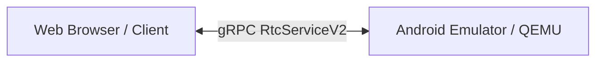
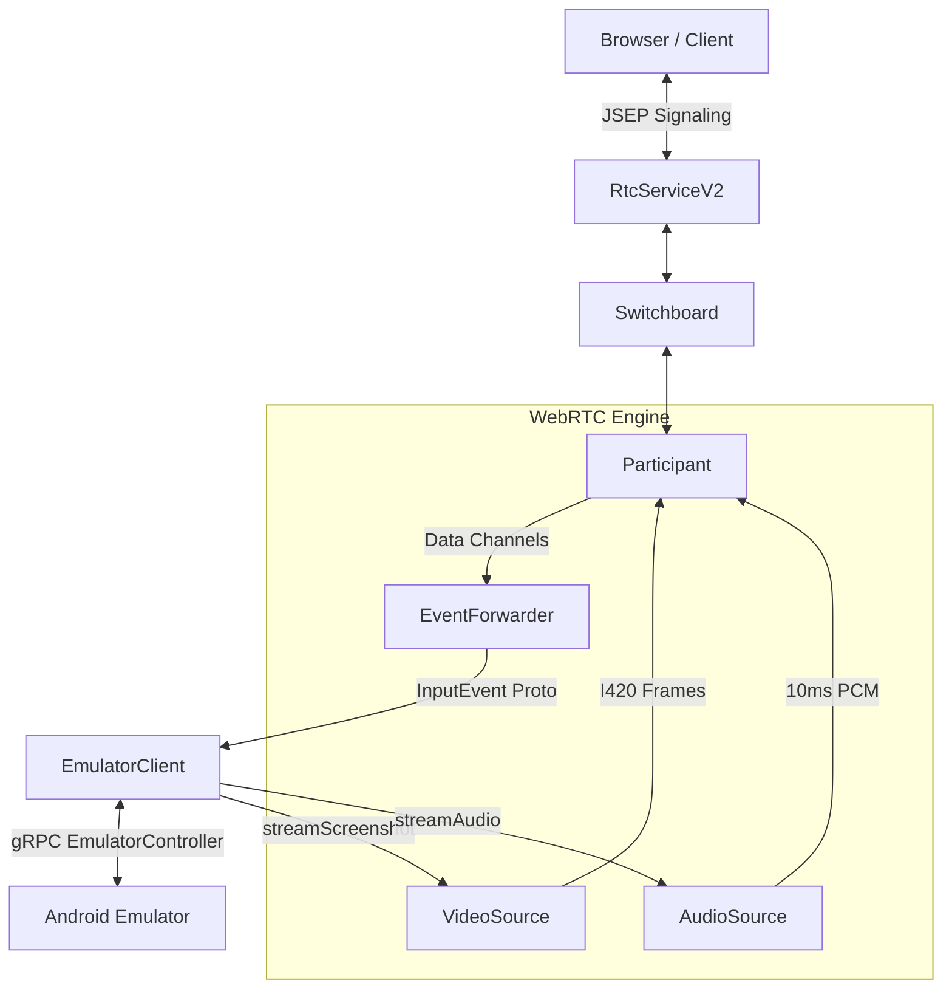
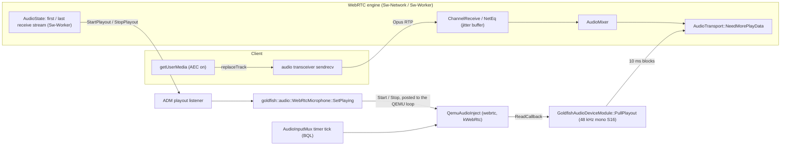

# Modern WebRTC Video Bridge Design

This document details the architecture, design, and internal workings of the
WebRTC Video Bridge in `emu-main-next`.

---

## 1. High-Level Architecture & Evolution

The WebRTC Video Bridge components deliver real-time, high-performance audio/video
streaming and user input data channel handling for Android instances.

### In-Process QEMU Integration

While the WebRTC engine previously operated as a standalone out-of-process proxy binary (`videobridge`), the Video Bridge has been integrated directly into QEMU / Android Emulator.

1. **Streamlined Deployment:** Clients (WebRTC Java SDK, Python Gateway, etc.) connect directly to the emulator's native gRPC service (`RtcServiceV2` / `grpc.port`) without requiring a separate proxy process or secondary port management.
2. **Reduced Latency:** Frames and input events are routed directly within QEMU, avoiding inter-process IPC or gRPC proxy hops.
3. **Flexible Architecture:** The core WebRTC C++ components (`Switchboard`, `Participant`, format pipelines, platform HW codecs) remain modular so they can be built into QEMU or used as standalone components where required.

---

## 2. A WebRTC Primer for Newcomers

To understand why the `videobridge` architecture is structured this way, we must
first understand how WebRTC works under the hood.

### 2.1 Peer-to-Peer (P2P) is Hard

WebRTC is designed to establish direct, low-latency, peer-to-peer audio, video,
and data streams between a browser and a remote endpoint (in this case, our
emulator). However, direct communication over the internet is blocked by
firewalls and Network Address Translators (NATs).

To solve this, WebRTC uses three core concepts:

1. **SDP (Session Description Protocol):** A text format describing the media
   capabilities of an endpoint (e.g., "I support VP8 video, Opus audio, and want
   to receive them at these resolutions").
2. **ICE (Interactive Connectivity Establishment):** A framework used to find
   all possible ways two peers can connect (local IP addresses, public IP
   addresses via STUN servers, or relayed connections via TURN servers). Each
   potential connection path is called an **ICE Candidate**.
3. **Signaling:** Before two peers can talk directly, they must exchange their
   SDPs (the "Offer" and the "Answer") and their ICE Candidates. WebRTC does
   _not_ define a signaling protocol. In our architecture, we use the gRPC
   `RtcServiceV2` endpoint directly for this exchange. If a client requires a
   different transport (like WebSockets to connect to a browser), a lightweight
   proxy gateway can be placed in front of the gRPC interface (as demonstrated
   in [DEMO.md](../gateway/DEMO.md)).

### 2.2 JSEP (JavaScript Session Establishment Protocol)

JSEP is the state machine that governs this exchange:

- **Step 1:** One peer (usually the browser) creates an **Offer** (SDP).
- **Step 2:** The browser sends this Offer to the Video Bridge via the
  **Signaling Channel** (our gRPC `RtcServiceV2`).
- **Step 3:** The Video Bridge applies this offer to its local WebRTC engine
  (`webrtc::PeerConnection`), generates an **Answer** (SDP), and sends it back
  to the browser.
- **Step 4:** Both sides trickle **ICE Candidates** to each other as they
  discover them. Once a viable network path is agreed upon, the P2P media
  connection is established.

---

## 3. Internal Components & Data Flow

Once signaling succeeds, the WebRTC engine takes over. The `videobridge` binary
hosts the following internal components to bridge WebRTC to the emulator:

### 3.1 `EmulatorClient`

A gRPC client wrapper that connects to the emulator's `EmulatorController`
service. It uses `EmulatorGrpcClientBuilder` to discover the emulator's port and
handles gRPC stream reactors for:

- **`StreamScreenshot`**: Requests a continuous stream of BGR24/RGBA screenshots
  from the emulator.
- **`StreamInputEvent`**: Pushes touch, mouse, and keyboard events back into the
  emulator.

### 3.2 `GrpcVideoSource`

A custom `webrtc::AdaptedVideoTrackSource` that coordinates the screenshot
capture loop. It is decoupled from format-specific details by delegating to a
`VideoFormatPipeline`:

- **Shared Memory (MMAP) Transport:** To achieve 60 FPS, the emulator writes
  frame buffers directly to a shared memory file mapped by the Video Bridge,
  eliminating gRPC serialization overhead. The size of the shared memory region
  is queried from the active pipeline.
- **Fallback Transport:** If shared memory mapping fails, it automatically falls
  back to receiving frames via standard gRPC protobuf byte payloads.
- **Multi-Format Extensibility:** Instead of hardcoding format details, it
  delegates gRPC configuration, shared memory sizing, and `webrtc::VideoFrame`
  construction to the injected `VideoFormatPipeline` strategy.

### 3.3 `VideoFormatPipeline`

An abstraction interface that encapsulates format-specific requirements and
conversions:

- **Format Negotiation:** Defines the gRPC `ImageFormat` to request from the
  emulator.
- **Memory Management:** Calculates the exact bytes required in the shared
  memory region for a given frame dimension.
- **Frame Construction:** Converts raw incoming bytes (e.g., RGBA pixels or
  native GPU handle metadata) and constructs the final `webrtc::VideoFrame` with
  the correct rotation and timestamps.
- **Supported Pipelines:**
  - `RgbaToNv12Pipeline`: The default pipeline. It requests `RGBA8888` from the
    emulator, converts it to `NV12` bi-planar YUV on the CPU using `libyuv::ABGRToNV12`,
    and packages it into a native `webrtc::NV12Buffer` to eliminate intermediate
    transcodes for hardware encoders (NVENC, VA-API, Media Foundation, VideoToolbox).
  - _Future Pipelines:_ `NativeTexturePipeline` (for zero-copy GPU texture streaming).

### 3.3 `Switchboard` & `Participant`

- **`Participant`**: Represents a single WebRTC connection. It wraps the
  `webrtc::PeerConnection` object, listens to WebRTC connection state changes,
  and configures the audio/video tracks.
- **`Switchboard`**: The orchestrator that manages multiple active `Participant`
  sessions. It acts as the routing table for the signaling layer, maintaining
  thread-safe FIFO message queues for each participant so that gRPC signaling
  requests are safely routed to the correct WebRTC signaling threads.

### 3.4 `EventForwarder`

An observer registered on WebRTC **Data Channels**:

- When the browser sends mouse clicks, key presses, or touch coordinates, they
  arrive over WebRTC SCTP data channels as binary protobuf packets.
- `EventForwarder` intercepts these, deserializes them, and writes them directly
  to the emulator's `StreamInputEvent` gRPC channel to inject input into the
  guest OS with sub-millisecond latency.

### 3.5 Platform Codec Factories & Hardware Acceleration

To deliver low-latency high-resolution video streams (such as `1080x2400` @ 60
FPS) without overloading the host CPU, the `videobridge` leverages
platform-specific hardware acceleration for video encoding and decoding.

The bridge instantiates `CompositeVideoEncoderFactory` and
`CompositeVideoDecoderFactory`. These custom wrappers prioritize the platform's
hardware-accelerated H.264 codecs and gracefully fall back to WebRTC's built-in
software codecs (VP8, VP9, AV1) if the hardware encoder fails or is not
supported.

#### Windows (Media Foundation)

On Windows, the bridge implements a custom `MFVideoEncoderH264` using the
Windows Media Foundation API. It enumerates and instantiates a
hardware-accelerated H.264 Encoder MFT (Media Foundation Transform).

- **Format Conversion:** The encoder converts incoming YUV frames to NV12 using
  `libyuv` and feeds them into the MFT.
- **Performance Optimizations:** To minimize heap allocations in the video
  pipeline's hot path, input and output samples/buffers are pre-allocated during
  initialization and reused for subsequent frames.
- **Threading and Lifecycle:** The Media Foundation MFT operates synchronously.
  To prevent race conditions where resources could be released while encoding is
  active, the `Encode` method holds an exclusive mutex lock for its entire
  duration.

#### macOS (VideoToolbox)

On macOS, the bridge uses `RTCVideoEncoderFactoryH264` and
`RTCVideoDecoderFactoryH264` from Apple's VideoToolbox framework. These are
wrapped into a native `webrtc::VideoEncoderFactory` via the
`webrtc::ObjCToNativeVideoEncoderFactory` bridge.

- **Lifetime Management:** Because Objective-C++ uses Automatic Reference
  Counting (ARC), the native C++ wrapper classes hold strong references
  (`objc_factory_`) to the underlying Objective-C factory objects to prevent
  them from being prematurely deallocated.
- **Level Elevation for High Resolutions:** By default, WebRTC's H.264 factory
  advertises **Level 3.1** (`profile-level-id=42e01f`), which caps the video
  resolution at `1280x720` at 30 FPS. High-resolution streams like `1080x2400`
  exceed the macroblock limits of Level 3.1, causing Apple's VideoToolbox to
  fail with `kVTParameterErr` (`-12902`) on macOS.

  To solve this, the composite factories intercept the advertised formats and
  elevate the H.264 `profile-level-id` to **Level 5.2** (`34` in hex), which
  supports up to 4K resolutions at 60 FPS (e.g. Constrained Baseline Profile is
  elevated to `42e034` and High Profile to `640c34`). This allows the browser to
  negotiate high-resolution streams that can be processed directly by the macOS
  GPU.

#### Linux (NVIDIA / VA-API)

_(Planned)_ Future versions will implement hardware-accelerated H.264 encoding
on Linux using NVIDIA's NVENC or Intel/AMD's VA-API to support GPU-accelerated
video encoding in Linux cloud environments. Currently, Linux hosts fall back to
WebRTC's built-in software codecs.

---

## 4. Microphone Injection (Client → Guest)

A client can send its microphone (for example a browser's `getUserMedia` track) to the
guest. The guest records it like any microphone, and `AudioService.GetAudioState` lists it
as a `MicrophoneInput.Kind.WEBRTC` input. This section covers the in-process deployment;
the standalone binary does not support it yet (§4.6).

### 4.1 Negotiation

The client is always the offerer, and the session is negotiated once. A client that may
send its microphone opts in when it connects (`microphone: true` in the web SDK) and offers
its audio transceiver as `sendrecv`, with no track attached. It then turns the microphone
on and off with `RTCRtpSender.replaceTrack()` alone, without renegotiating:

| Client action | Offer direction | WebRTC on the emulator | `GoldfishAudioDeviceModule` |
| :--- | :--- | :--- | :--- |
| Connect with `microphone: true` | `sendrecv` | Creates a receive stream for the advertised SSRC | `StartPlayout()` → listener `true` |
| `replaceTrack(mic)` / `replaceTrack(null)` | unchanged | RTP starts / stops on the same stream | nothing |
| Session closed or failed | n/a | Removes the receive stream | `StopPlayout()` (twice) → listener `false` once |
| Connect without the option | `recvonly` | No receive stream | nothing |

The emulator's speaker track is added with `AddTrack` before the offer arrives. So the
client's audio m-line binds to that transceiver and is answered `sendrecv`: a single
m-line carries both the speaker and the microphone.

Chrome, Safari (both libwebrtc) and Firefox advertise an SSRC and `msid:-` for a `sendrecv`
sender without a track, so the receive stream, and with it playout, exists from the
start. A client that omitted the SSRC would start playout at its first RTP packet
instead. Playout is a session-wide signal: it cannot tell which session sends, which is
fine for a single controlling client (see §4.2).

### 4.2 Pipeline

- **The guest clock drives decoding.** WebRTC decodes received audio only when its audio
  device module asks for playout data. `GoldfishAudioDeviceModule` has no playout thread,
  so nothing is decoded until `PullPlayout()` is called. `WebRtcMicrophone`'s
  `ReadCallback` calls it whenever the guest's capture timer needs samples. NetEq is the
  only jitter buffer, so there is no second clock and no drift to correct. Nothing is
  decoded while no guest app records.
- **When the input exists.** WebRTC starts playout when the first receive audio stream
  appears and stops it when the last one goes away. The module reports each change to its
  playout listener, and `WebRtcMicrophone` keeps one injector, `source_id = "webrtc"`,
  for as long as playout runs. It is silent while no client has a track attached.
- **Mixing.** WebRTC's mixer combines every sending session into the pulled audio. The
  guest-side `AudioInputMux` then mixes the `"webrtc"` input with any other injectors, so
  a person's browser microphone and an agent's `AudioService` stream are heard together.
  Like any injector, it replaces the host microphone while it runs.
- **Full mixer.** If `kMaxConcurrentMicrophoneStreams` injectors are already running,
  `Start()` returns `RESOURCE_EXHAUSTED`. `WebRtcMicrophone` logs a warning once per
  playout, watches the mixer state, and adds the input as soon as it fits. Other
  failures (no microphone mixer on this device, or the emulator shutting down) last, so
  it logs that the WebRTC audio is dropped and does not retry. The mixer reserves
  `"webrtc"` for this input, so no other client can take the name.
- **Wiring.** `CreateInProcessSwitchboard()` creates the `GoldfishAudioDeviceModule`. It
  passes the module to the `Switchboard` (which hands it to the `PeerConnectionFactory`)
  and to `CreateInProcessMediaProvider()`. The provider sets the playout listener to
  `WebRtcMicrophone::SetPlaying`, gives the microphone a pull function on the module, and
  clears the listener when it is destroyed.

### 4.3 Threading and Lock Order

| Step | Thread | Locks |
| :--- | :--- | :--- |
| `StartPlayout` / `StopPlayout` → listener → `SetPlaying` | `Sw-Worker` | ADM `playout_mutex_` (leaf); posts to the QEMU loop |
| `WebRtcMicrophone::Update` → `Start` / `Stop` | QEMU main loop | BQL (`RecursiveScopedVmLock`) |
| Mixer state observer (retry while the mixer is full) | Any thread changing the mixer | BQL; only posts to the QEMU loop |
| `ReadCallback` → `PullPlayout` → `NeedMorePlayData` | QEMU main loop (mux timer) | BQL → ADM `mutex_` → mixer `mutex_` → `ChannelReceive::neteq_mutex_` |
| RTP arrival → `NetEq::InsertPacket` | `Sw-Worker` | `neteq_mutex_` |
| Voice engine start / stop → `RegisterAudioCallback` | `Sw-Worker` | ADM `mutex_` |

- No WebRTC thread takes or waits for the BQL. A BQL holder such as QEMU teardown may
  block on a WebRTC thread, so taking the microphone is always posted to the QEMU loop.
  The lock order is therefore one-way, BQL first, and cannot deadlock.
- The WebRTC locks taken under the BQL (`AudioMixerImpl::mutex_`,
  `ChannelReceive::neteq_mutex_`, the ADM `mutex_`) are held elsewhere only for short,
  non-blocking sections: packet insertion, stats, codec changes and source add/remove.

### 4.4 Guest Impact

> **Decision (reviewed 2026-10):** keep decoding on the guest's pull, under the BQL. The
> numbers below were judged acceptable. Re-measure as described at the end of this section
> rather than re-deriving the analysis; switch to the fallback only if they regress.

A pull decodes Opus and runs NetEq and the mixer while the BQL is held, so any vCPU
needing the BQL waits for it. This was measured on an Apple M-series host (`-c opt`;
`remote_audio_test` with a real Opus stream; 980 pulls, three runs):

| Case | Per-call CPU time | BQL time per 10 ms of audio |
| :--- | :--- | :--- |
| Steady state, one 10 ms block | p50 ≈ 55 µs, p99 ≈ 180 µs, max ≈ 250 µs | ≈ 0.5% typical, ≤ 2.5% worst |
| No packets (NetEq concealment) | p50 ≈ 47 µs, max ≈ 400 µs | similar |
| 200 ms backlog drained in one tick (after a VM stall) | ≈ 0.8–1.1 ms, once | one-off |

- The audio input pacer caps any backlog at 200 ms. One pull therefore never decodes more
  than 20 blocks.
- Wall time occasionally reached 1–7 ms with unchanged CPU time. A lock-free compute
  loop on the same thread showed the same spikes at the same rate. They are host
  scheduler preemption, which can hit any BQL holder, not lock contention.
- The cost is paid only while a guest app records *and* a WebRTC peer sends. The existing
  speaker path (`QemuAudioSource`) already calls into WebRTC under the BQL.
- Fallback if this budget is ever too high: a dedicated playout thread decodes into a
  small ring buffer, and the BQL path only copies from it (the
  `QemuMicrophoneSession` pattern). The price is a thread, a ring buffer, 10–20 ms of extra
  latency, and drift handling between the host and virtual clocks.

**How to re-measure.** In `remote_audio_test`'s `MicrophoneToneComesOutOfPlayout`:
- Run about 1000 iterations instead of 150.
- Around each `PullPlayout()` call, record wall time (`absl::Now()`) and thread CPU time
  (`clock_gettime(CLOCK_THREAD_CPUTIME_ID)`).
- Print p50, p99 and max of both.
- As a control, time a lock-free compute loop of similar length on the same thread. If
  wall-time spikes show up in the control at the same rate, they are scheduler
  preemption. Spikes in wall time but not CPU time that appear only around
  `PullPlayout()` would mean lock waits.
- Run with
  `bazel test -c opt --test_output=all --test_filter='*Tone*' --cache_test_results=no
  @goldfish//emulator/videobridge:remote_audio_test`.

### 4.5 Testing

- `goldfish_audio_device_module_test`: block chunking, leftover handling, short blocks,
  engine registration, and the playout listener (changes reported once, late and
  cleared listeners).
- `remote_audio_test`: a client `PeerConnection` on the same factory and in-memory
  network, negotiating like the web SDK. A `sendrecv` offer starts playout before any
  track is attached, a `recvonly` one never does, a 1 kHz tone sent after `replaceTrack`
  comes out of `PullPlayout` (checked with Goertzel), and removing the track keeps
  playout until the session closes.
- `webrtc_microphone_test` (`emulator/plugin/audio`): the `"webrtc"` input's lifetime,
  mixing with an agent's gRPC stream, retrying when the mixer is full, dropping the audio
  when there is no mixer, the reserved name, and teardown.
- `in_process_rtc_service_test`: `StartPlayout` on the shared module gives the guest a
  `"webrtc"` input that records what the module plays out.

### 4.6 Standalone `videobridge` (deferred)

The standalone binary has no guest clock and no in-process mixer, so it ignores client
microphones today. This was scoped and deferred until someone needs it. The scope was one
CL of about 250 production and 200 test lines:
- A v2 `AudioService` stub on `EmulatorClient`.
- A `GrpcMicrophoneForwarder`. It follows the playout listener like `WebRtcMicrophone`.
  While playout runs, a 10 ms steady-clock thread pulls `PullPlayout()` and writes
  `AudioChunk`s to `AudioService.StreamMicrophoneAudio`.
- Wiring in `videobridge.cpp`.

Trade-offs:
- 20–60 ms more latency than in-process.
- Host-clock and guest-clock drift, absorbed by the server's buffer.
- The input reports as `GRPC_STREAM`, because `Kind` is output-only.
- The bridge's token needs write access to `AudioService`.

---
